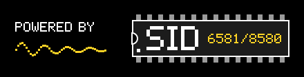
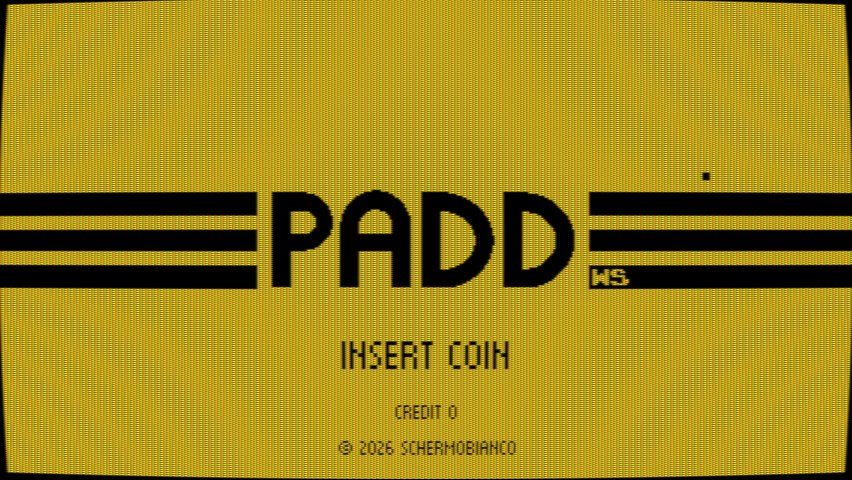
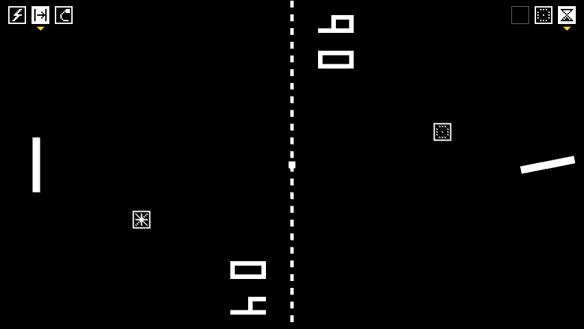
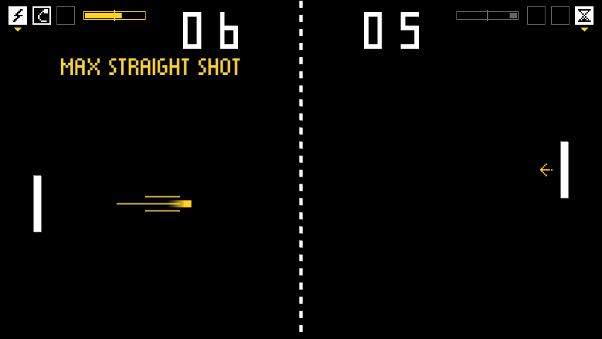
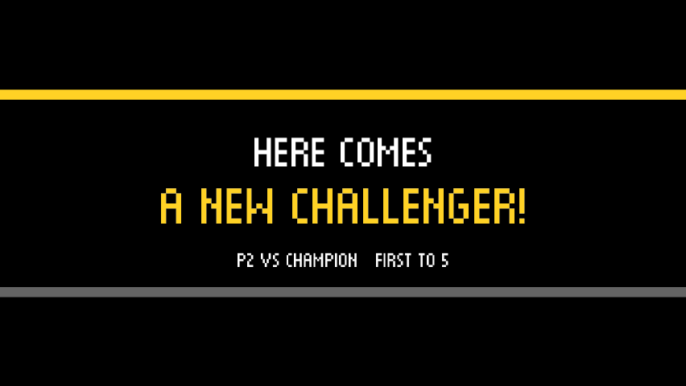
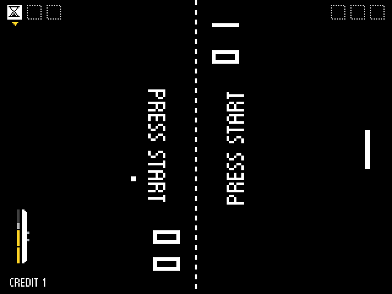
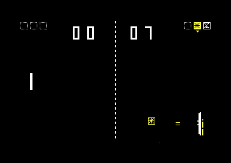
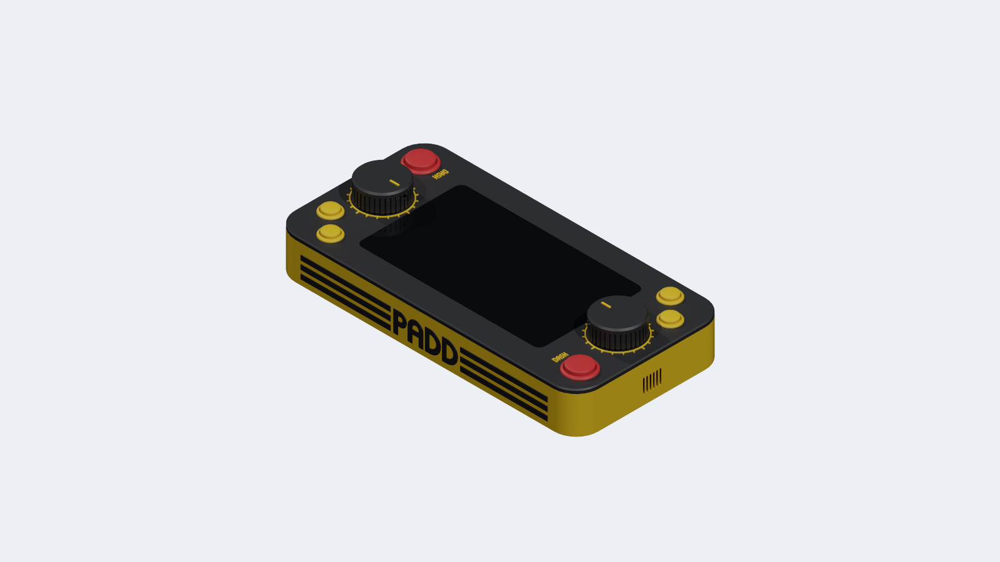
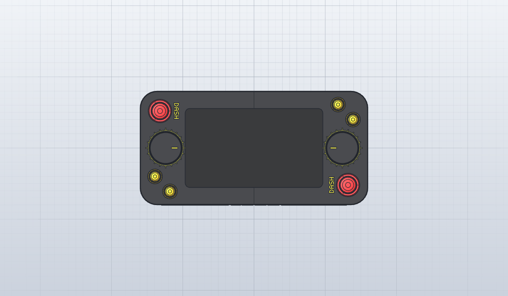
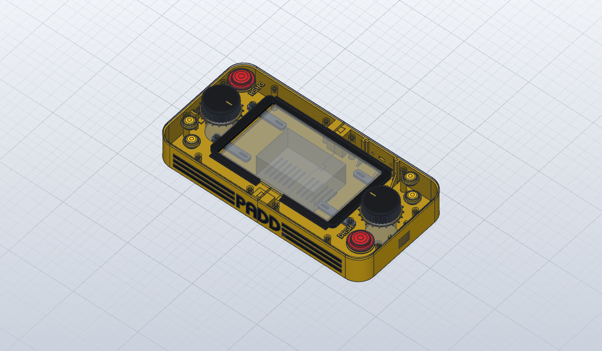

[ Italiano](README.md) · [ **English**](README.en.md)

# PADD WS

  <picture>
    <source media="(prefers-color-scheme: dark)" srcset="docs/paddws-logo-dark.png">
    
  </picture>

Table-top Pong for two players sitting at opposite ends of the screen, with an 80s arcade attract
mode, coin-op credits, power-ups, fighting-game special moves and a ladder against seven
opponents. It runs on PC, in the browser, in a Raspberry Pi cabinet, on the MiSTer FPGA and on the
Commodore 64, and everywhere it plays exactly the same match.

Music, sound effects and voices come from a SID, the Commodore 64 sound chip: the real one on the
C64, the one from the C64 core on the MiSTer and a SID written in Rust on PC, Raspberry and web.

## Play now

**<https://schermobianco.github.io/PaddWS/>**: in the browser, on a computer, a phone or a tablet
(in landscape). On the phone the paddle follows your finger; on the computer you play with the
keyboard, a gamepad or the mouse.

## Screenshots

| | |
|---|---|
|  |  |
| Attract mode title, with the CRT filter | NEXT: power-ups in the reserves at the top and capsules in flight |
|  |  |
| Special moves: MAX STRAIGHT SHOT in flight | CHALLENGE: a second player joins in |
|  |  |
| MiSTer core at 320×240 | Commodore 64: NEXT |

More screenshots in [How to play](docs/en/how-to-play.md#screenshots).

## Modes

- **CLASSIC**: good old Pong, two players up to 11 points, or alone against a wall with 3 balls.
- **EVO**: hitting the ball with the centre of the paddle powers it up; the forward dash
  intercepts the ball and sends it back.
- **NEXT**: before the match each player picks 3 power-ups out of 6 (TELEPORT, SMASH, SLOW, CURVE,
  GHOST, STEER) and one of seven paddle types; power-ups arrive in capsules to be collected. There
  are also two special moves, performed with a specific sequence of inputs.
- **VS CPU**: CLASSIC and EVO alone against the computer; alone in NEXT you play the CHALLENGE.
- **CHALLENGE**: alone against 7 ever stronger CPU opponents, with arcade scoring, continues, a
  high-score table and an ending. A second player can join in and challenge whoever is playing:
  *HERE COMES A NEW CHALLENGER!*

Rules, power-ups, paddles, moves and controls: **[How to play](docs/en/how-to-play.md)**.

## Versions

| version | runs on | download |
|---|---|---|
| **Web** (Rust in WebAssembly) | browser on computers, Android, iPhone and iPad | play [online](https://schermobianco.github.io/PaddWS/), or `paddws-X.Y.Z-web.zip` |
| **Rust** (macroquad), a single executable | Windows, Linux x86_64, Raspberry Pi (Linux ARM64 and 32-bit ARM) | `paddws-X.Y.Z-windows-x86_64.zip`, `-linux-x86_64.tar.gz`, `-linux-aarch64.tar.gz`, `-linux-armv7.tar.gz`: runs straight away |
| **MiSTer core** FPGA, 320×240 at 15 kHz | DE10-Nano with MiSTer | `PaddWS_MiSTer_YYYYMMDD.zip`: unzip it into the root of the SD card (`/media/fat`), it shows up among the arcade titles |
| **Commodore 64** (preview, PAL), 6502 assembly | C64, C64 Ultimate, VICE | `paddws-X.Y.Z-c64.zip`: the EasyFlash cartridge `paddws.crt` |
| **Python** (Arcade 3.3), the first version | Windows, Linux, macOS, Raspberry Pi | `paddws-X.Y.Z-python.zip`: `pip install -r python/requirements.txt`, then `python python/main.py` |

Everything is in the [releases](https://github.com/Schermobianco/PaddWS/releases). The Python
version is frozen: it has CLASSIC and EVO, without the CPU, NEXT or CHALLENGE. What each version
has: [table](docs/en/how-to-play.md#features-by-version).

The reference game logic is the Rust core: deterministic, integers only, in fixed point. The
MiSTer core and the C64 version reproduce its state tick by tick, verified bit for bit.

## Controls at a glance

| | keys |
|---|---|
| PC, left player | `W` / `S` up and down, `D` dash, `F` / `C` select and use the power-up |
| PC, right player | `↑` / `↓`, `←` dash, `.` / `-` power-up |
| PC, general | `5` coin, `Enter` or `1` Start, `P` pause, `Esc` menu, `F11` full screen, `C` CRT filter (outside NEXT) |
| gamepads and arcade sticks | stick or d-pad, **A** dash, **B** / **C** power-up, **Start**, **Select** coin |
| phones and tablets | the paddle follows your finger, a second finger dashes, a tap on ❚❚ pauses |
| MiSTer | joystick, paddle or spinner; options in the OSD |
| Commodore 64 | joysticks in ports 2 and 1, or two paddles in port 1 |

All the controls, including the mouse as a spinner and the cabinet's encoders:
[How to play](docs/en/how-to-play.md#controls).

## A console to print

The [Deck](hardware/deck/README.en.md) is a 3D-printable table-top console: a Raspberry Pi with
the official 7" display, a knob on an optical encoder at each end and the DASH, SELECT and USE
buttons. It comes with the SolidCraft model and a STEP file, the Bambu Studio project with the
parts already split into plates (no supports, one colour per plate) and the assembly instructions.
For the Pi 2 there is a ready-made [SD card image](deploy/raspberry/deck/README.en.md)
(`paddws-X.Y.Z-deck-pi2.img.xz` in the releases): it boots into the game in about 8 seconds and is
switched off by pulling the plug.

| | |
|---|---|
|  |  |
| From above: knobs with 20 notches, DASH, SELECT and USE at both ends | Inside: pillars, display bars and dovetails between the two halves |

## Documentation

- [How to play](docs/en/how-to-play.md): modes, power-ups, paddles, special moves, CHALLENGE,
  sound, controls for every version.
- [Configuration](docs/en/configuration.md): `padd_config.json`, difficulty, NEXT parameters,
  Raspberry Pi cabinet.
- [Development](docs/en/development.md): structure, building, tests and checks, releases.
- [Ball angle](docs/en/ball-angle.pdf) (PDF): how the direction is chosen at launch and on hits,
  the TWIST paddle and a comparison with the 1972 Pong.
- [The Deck](hardware/deck/README.en.md): the console to print, parts, components and assembly.
- [Raspberry Pi cabinet](deploy/raspberry/README.en.md): models, encoder wiring, installation.
- The individual versions: [Rust](rust/README.en.md), [MiSTer core](mister/README.en.md),
  [Commodore 64](c64/README.en.md).
- What's new in each version (in Italian): [CHANGELOG.md](CHANGELOG.md).

## Contributing

Bugs and ideas go in an issue, changes in a pull request, in English or Italian. How the work is
done and which checks are needed is explained in [CONTRIBUTING.en.md](CONTRIBUTING.en.md). Questions go to
[Discussions](https://github.com/Schermobianco/PaddWS/discussions); everyone taking part follows the
[code of conduct](CODE_OF_CONDUCT.md), and security issues are reported privately
([SECURITY.md](SECURITY.md)).

## License

Copyright © 2020-2026 Schermobianco.

The PADD WS code (Rust, C64, Python, tools) is free software: you can redistribute and modify it
under the terms of the [GNU General Public License v3](LICENSE) or, at your option, any later
version. Whoever distributes it, even for a fee and even modified, must provide the source code
under the same license. The MiSTer core is GPL v2 or later, because it is built on the MiSTer
framework ([mister/LICENSE](mister/LICENSE)), and includes the SID emulation of the MiSTer C64
core, partly under the CERN-OHL-S v2 license. Fonts, dependencies and the other third-party parts
are listed in [THIRD_PARTY.md](THIRD_PARTY.md), with their licenses. Up to 4.0.0-beta.16 the code
was distributed under the MIT license.
