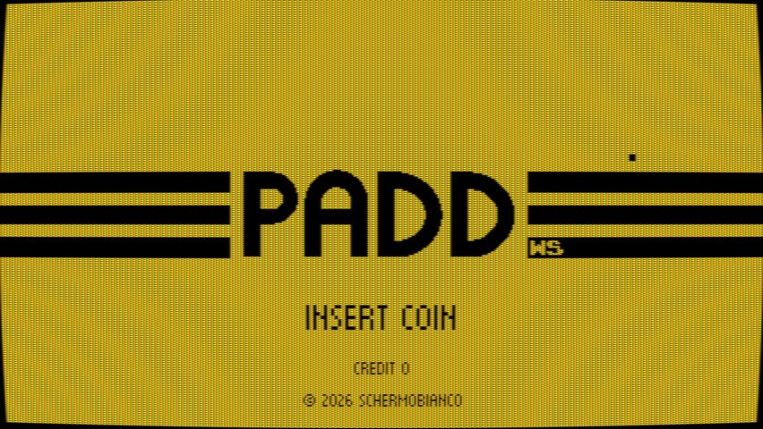
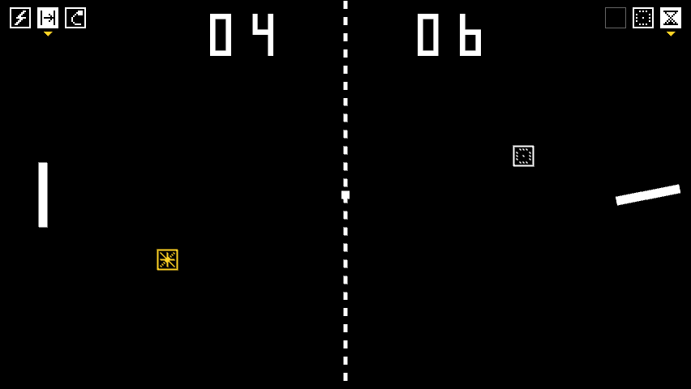
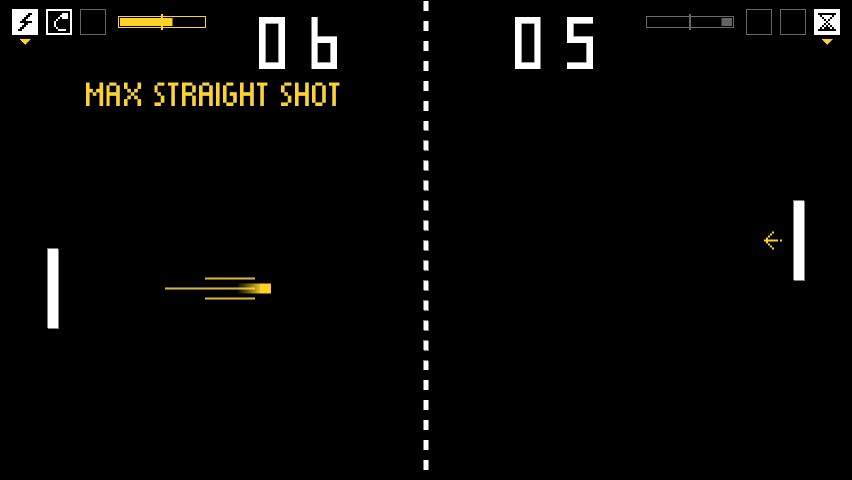
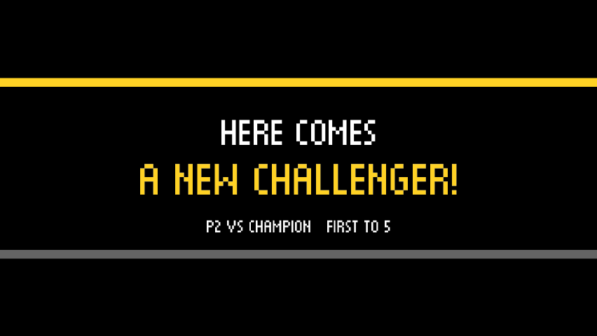
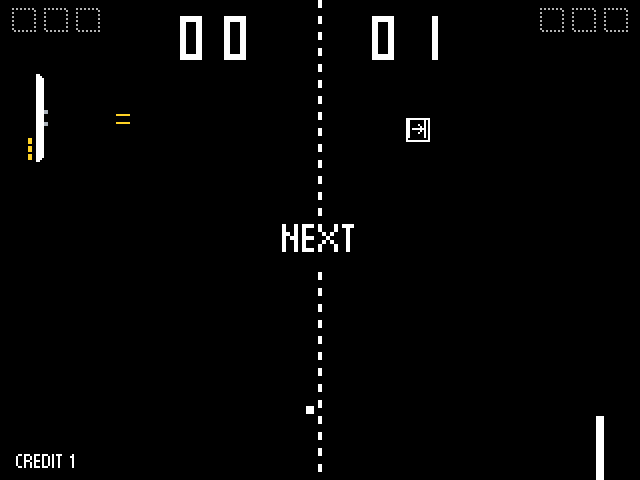
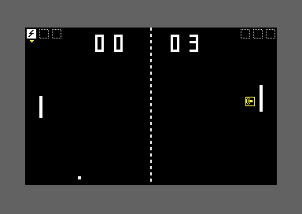

# PADD WS

Pong da tavolo per due giocatori seduti ai lati opposti dello schermo, con l'attract dei cabinati
anni '80, le partite a gettoni, i bonus, le mosse speciali da picchiaduro e una scalata contro sette
avversari. Gira su PC, nel browser, su un cabinato Raspberry Pi, sul MiSTer FPGA e sul Commodore 64,
e ovunque si gioca la stessa identica partita.

## Gioca subito

**<https://schermobianco.github.io/PaddWS/>**: nel browser, dal computer, dal telefono o dal tablet
(in orizzontale). Sul telefono la racchetta segue il dito; sul computer si gioca con tastiera,
gamepad o mouse.

## Schermate

| | |
|---|---|
|  |  |
| Titolo dell'attract, con il filtro CRT | NEXT: bonus nelle riserve in alto e capsule in volo |
|  |  |
| Mosse speciali: MAX STRAIGHT SHOT in volo | CHALLENGE: entra un secondo giocatore |
|  |  |
| Core MiSTer a 320×240 | Commodore 64: NEXT contro la CPU |

Altre schermate in [Come si gioca](docs/come-si-gioca.md#schermate).

## Modalità

- **CLASSIC**: il Pong di sempre, in due fino a 11 punti, oppure da soli contro un muro con 3 palle.
- **EVO**: colpendo la palla al centro della racchetta la si potenzia; lo scatto in avanti la
  intercetta e la rilancia.
- **NEXT**: prima della partita ognuno sceglie 3 bonus su 6 (TELEPORT, SMASH, SLOW, CURVE, GHOST,
  STEER) e uno di sette tipi di racchetta; i bonus arrivano in capsule da raccogliere. Con
  **SUPER MOVES: ON** ci sono anche due mosse speciali da fare con un gesto del controllo.
- **VS CPU**: tutte le modalità da soli contro il computer.
- **CHALLENGE**: da soli contro 7 avversari CPU sempre più forti, con punti arcade, continue,
  classifica e il finale. Un secondo giocatore può entrare come in Street Fighter 2: *HERE COMES A
  NEW CHALLENGER!*

Regole, bonus, racchette, mosse e comandi: **[Come si gioca](docs/come-si-gioca.md)**.

## Versioni

| versione | dove gira | si scarica |
|---|---|---|
| **Web** (Rust in WebAssembly) | browser su computer, Android, iPhone e iPad | si gioca [online](https://schermobianco.github.io/PaddWS/), oppure `paddws-X.Y.Z-web.zip` |
| **Rust** (macroquad), un eseguibile | Windows, Linux x86_64, Raspberry Pi (Linux ARM64) | `paddws-X.Y.Z-windows-x86_64.zip`, `-linux-x86_64.tar.gz`, `-linux-aarch64.tar.gz`: si avvia direttamente |
| **Core MiSTer** FPGA, 320×240 a 15 kHz | DE10-Nano con MiSTer | `PaddWS_MiSTer_AAAAMMGG.zip`: si scompatta nella radice della SD (`/media/fat`), compare tra i titoli arcade |
| **Commodore 64** (anteprima, PAL), assembly 6502 | C64, C64 Ultimate, VICE | `paddws-X.Y.Z-c64.zip`: la cartuccia EasyFlash `paddws.crt` |
| **Python** (Arcade 3.3), la prima versione | Windows, Linux, macOS, Raspberry Pi | `paddws-X.Y.Z-python.zip`: `pip install -r requirements.txt`, poi `python main.py` |

Tutto è nelle [release](https://github.com/Schermobianco/PaddWS/releases). La versione Python è
congelata: ha CLASSIC ed EVO, senza CPU, NEXT né CHALLENGE. Cosa c'è su ogni versione:
[tabella](docs/come-si-gioca.md#funzioni-per-versione).

La logica di gioco di riferimento è il core Rust: deterministico, solo interi in virgola fissa.
Il core MiSTer e la versione C64 ne riproducono lo stato tick per tick, verificato bit per bit.

## Comandi in breve

| | tasti |
|---|---|
| PC, giocatore sinistro | `W` / `S` su e giù, `D` scatto, `F` / `C` seleziona e usa il bonus |
| PC, giocatore destro | `↑` / `↓`, `←` scatto, `.` / `-` bonus |
| PC, generali | `5` gettone, `Invio` o `1` Start, `P` pausa, `Esc` menu, `F11` schermo intero, `C` filtro CRT |
| gamepad e stick arcade | levetta o croce, **A** scatto, **B** / **C** bonus, **Start**, **Select** gettone |
| telefono e tablet | la racchetta segue il dito, un secondo dito fa lo scatto, un tocco su ❚❚ mette in pausa |
| MiSTer | joystick, paddle o spinner; opzioni nell'OSD |
| Commodore 64 | joystick nelle porte 2 e 1, oppure due paddle nella porta 1 |

Tutti i comandi, mouse come spinner ed encoder del cabinato compresi:
[Come si gioca](docs/come-si-gioca.md#comandi).

## Documentazione

- [Come si gioca](docs/come-si-gioca.md): modalità, bonus, racchette, mosse speciali, CHALLENGE,
  suono, comandi di ogni versione.
- [Configurazione](docs/configurazione.md): `padd_config.json`, difficoltà, parametri di NEXT,
  cabinato Raspberry Pi.
- [Sviluppo](docs/sviluppo.md): struttura, compilazione, test e verifiche, release.
- Le singole versioni: [Rust](rust/README.md), [core MiSTer](mister/README.md),
  [Commodore 64](c64/README.md), [cabinato Raspberry Pi](deploy/raspberry/README.md).
- Le novità di ogni versione: [CHANGELOG.md](CHANGELOG.md).

## Licenza

Copyright © 2020-2026 Schermobianco.

Il codice di PADD WS (Rust, C64, Python, strumenti) è software libero: si può ridistribuire e
modificare secondo la [GNU General Public License v3](LICENSE) o, a scelta, una versione successiva.
Chi lo distribuisce, anche a pagamento e anche modificato, deve dare i sorgenti con la stessa
licenza. Il core MiSTer è GPL v2 o successiva, perché costruito sul framework del MiSTer
([mister/LICENSE](mister/LICENSE)), e include l'emulazione del SID del core C64 del MiSTer, in parte
con licenza CERN-OHL-S v2. Font, dipendenze e le altre parti di terzi sono elencati in
[THIRD_PARTY.md](THIRD_PARTY.md), con le loro licenze. Fino alla 4.0.0-beta.16 il codice era
distribuito con licenza MIT.
