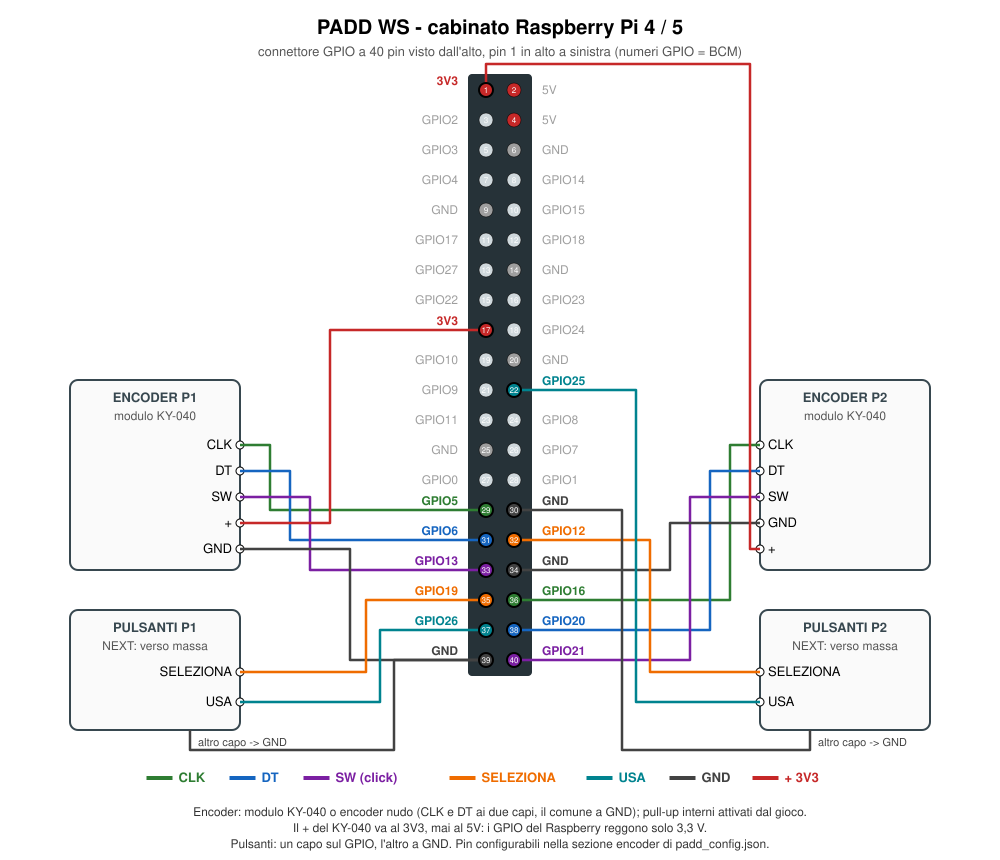
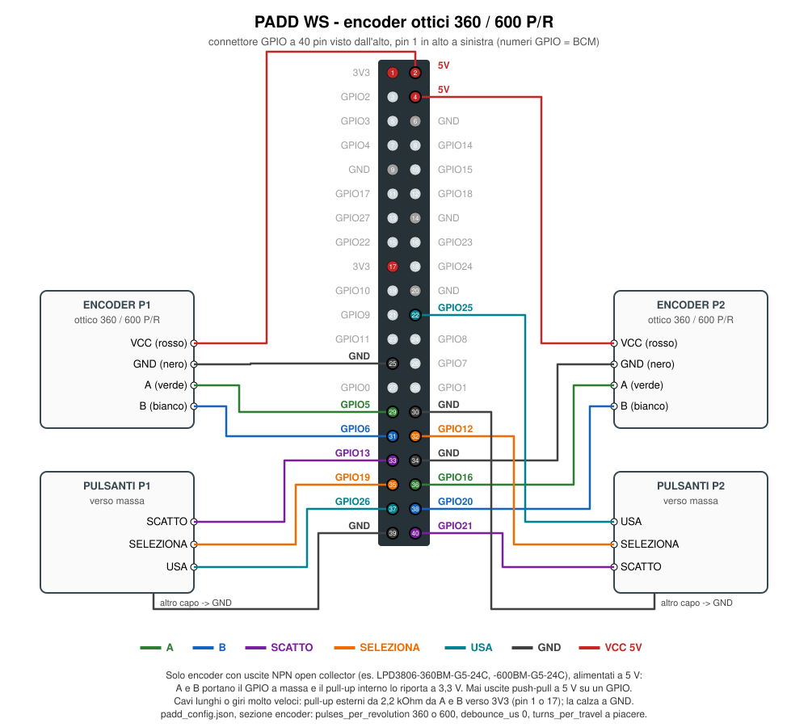

[ Italiano](README.md) · [ **English**](README.en.md)

# Installing on Raspberry Pi

For the Deck (32-bit Pi 2 with the 7" display) there is a ready-made SD card image that boots
straight into the game and survives the power being cut: [deck/README.en.md](deck/README.en.md).

Tested target: Raspberry Pi 4/5 with Raspberry Pi OS (desktop, X11); for other models see below.
The cabinet runs either the Python version or the Rust version: they share the same
`padd_config.json` and have one systemd service each, and only one is enabled.

| | Python | Rust |
|---|---|---|
| modes | Classic, EVO | Classic, EVO, NEXT, against the CPU |
| encoders | pigpio daemon (not available on the Pi 5) | kernel GPIO, Pi 4 and Pi 5, no daemon |
| NEXT buttons | – | SELECT and USE for each player |
| service | `paddws.service` | `paddws-rust.service` |

## Models

The Rust version uses the `linux-aarch64` executable from the release with **64-bit** Raspberry
Pi OS, or `linux-armv7` with **32-bit** Raspberry Pi OS (Bookworm or later in both cases).

| model | Rust version | notes |
|---|---|---|
| Pi 5, Pi 4, Pi 400 | yes | the main target |
| Pi 3, 3B+, 3A+, Zero 2 W | yes, with the 64-bit system | VideoCore IV graphics (OpenGL 2.1): enough for the game, better keep the CRT filter off; not tried on a real Pi 3 yet |
| Pi 2 v1.2 (BCM2837, like the Pi 3) | yes, with the 64-bit system | like the Pi 3 |
| Pi 2 v1.1 (BCM2836) | yes, with the 32-bit system and the `linux-armv7` executable | 32-bit-only processor; VideoCore IV graphics like the Pi 3; not tried on a real Pi 2 yet |
| Pi 1, Zero, Zero W | no | too old (ARMv6) |

The Pi 2 revision is printed on the board ("V1.1" or "V1.2"); from a terminal,
`cat /proc/device-tree/model` spells out the model and revision (for example "Raspberry Pi 2
Model B Rev 1.1"). To tell whether the system is 64-bit: `uname -m` answers `aarch64` (64 bit,
`linux-aarch64` executable) or `armv7l` (32 bit, `linux-armv7` executable, also for a Pi 3 running
the 32-bit system). The encoders are read from the kernel GPIO on all models.

## Wiring

The Rust version accepts two kinds of encoders, with the same program: mechanical detent encoders
like the KY-040 (20 detents per turn, with a push button) or optical ones with 360 or 600 pulses
per turn (no detents and no button: the forward dash goes on a separate arcade button, on the same
GPIO as SW). The pins are the same; power and buttons change.

The wiring diagrams are labelled in Italian: SELEZIONA is SELECT, USA is USE, SCATTO is DASH.

### KY-040 encoders



| | CLK | DT | SW (click) | SELECT | USE | GND | + |
|---|---|---|---|---|---|---|---|
| player 1 | GPIO5 (pin 29) | GPIO6 (pin 31) | GPIO13 (pin 33) | GPIO19 (pin 35) | GPIO26 (pin 37) | pin 39 | 3V3 (pin 17) |
| player 2 | GPIO16 (pin 36) | GPIO20 (pin 38) | GPIO21 (pin 40) | GPIO12 (pin 32) | GPIO25 (pin 22) | pin 34, 30 | 3V3 (pin 1) |

- Encoder: KY-040 module or bare encoder (CLK and DT on the two outer legs, the common one to GND).
  The Rust version turns on the internal pull-ups on all lines, so a bare encoder works too.
- The KY-040 `+` goes to **3V3, never to 5V**: the Raspberry GPIOs only take 3.3 V.
- Buttons (encoder SW, SELECT, USE): one leg on the GPIO, the other to GND.
- The pins are changed in the `encoder` section of `padd_config.json` (GPIO numbers, that is BCM):
  `e1_clock_pin`, `e1_data_pin`, `e1_switch_pin`, `e2_...` as in the Python version, plus
  `e1_select_pin`, `e1_activate_pin`, `e2_select_pin`, `e2_activate_pin` (Rust only; a negative
  number = no button). Without the new keys the pins of the diagram apply.

### Optical encoders 360 / 600 P/R



| | A (green) | B (white) | VCC (red) | GND (black) | DASH | SELECT | USE |
|---|---|---|---|---|---|---|---|
| player 1 | GPIO5 (pin 29) | GPIO6 (pin 31) | 5V (pin 2) | pin 25 (buttons: 39) | GPIO13 (pin 33) | GPIO19 (pin 35) | GPIO26 (pin 37) |
| player 2 | GPIO16 (pin 36) | GPIO20 (pin 38) | 5V (pin 4) | pin 34 (buttons: 30) | GPIO21 (pin 40) | GPIO12 (pin 32) | GPIO25 (pin 22) |

- Only encoders with **NPN open collector** outputs (for example LPD3806-360BM-G5-24C and
  -600BM-G5-24C; the wire colours are the usual ones for these models): powered at 5 V, the A and
  B outputs pull the GPIO to ground and the internal pull-up brings it back to 3.3 V, so 5 V never
  reaches the Raspberry. An encoder with push-pull (voltage) outputs powered at 5 V needs a level
  shifter: 5 V on a GPIO damages it.
- With long cables or very fast spinning: external 2.2 kΩ pull-ups from A and from B to 3V3
  (pin 1 or 17). The cable shield, if there is one, goes to GND.
- In `padd_config.json`, `encoder` section: `"pulses_per_revolution": 360` (or `600`) and
  `"debounce_us": 0` (debouncing is only for mechanical contacts and would cut real edges).

| key | default | |
|---|---|---|
| `pulses_per_revolution` | `20` | pulses per turn: up to 30 the encoder has detents (KY-040), above that every transition counts |
| `turns_per_travel` | `1.0` | knob turns to move the paddle from one edge to the other (`0.5` = half a turn) |
| `debounce_us` | `500` | debounce in microseconds; `0` for optical encoders |

### Controls

Controls with the encoders: rotation = paddle (one turn for the whole travel), click = forward
dash, long press (1.5 s) = menu; in the menu rotation picks (one item every twentieth of a turn)
and click confirms; in attract mode click counts as Start. With optical encoders the click is the
DASH button. In NEXT: SELECT moves to the next power-up in reserve, USE activates it; with STEER
the knob turned away from the (stopped) paddle steers the ball.

## Rust version

```sh
# from the latest release: paddws-X.Y.Z-linux-aarch64.tar.gz (64-bit Raspberry Pi OS)
# or paddws-X.Y.Z-linux-armv7.tar.gz (32-bit Raspberry Pi OS, Pi 2 v1.1)
mkdir -p /home/pi/paddws-rust
tar xzf paddws-*-linux-aarch64.tar.gz --strip-components=1 -C /home/pi/paddws-rust
```

In `/home/pi/paddws-rust/padd_config.json` set `"encoder": {"enabled": true, ...}`. Then:

```sh
sudo cp deploy/raspberry/paddws-rust.service /etc/systemd/system/
sudo systemctl daemon-reload
sudo systemctl disable --now paddws.service     # if the Python version was enabled
sudo systemctl enable --now paddws-rust.service
journalctl -u paddws-rust.service -f            # log: "Encoders on GPIO [...]" if the encoders are on
```

To go back to the Python version: `disable --now paddws-rust.service` and `enable --now
paddws.service`. The game reads the file next to the executable; the SHUTDOWN menu item only
appears on Raspberry Pi and runs `sudo shutdown -h now`.

## Python version

```sh
sudo apt install python3-venv pigpio
sudo systemctl enable --now pigpiod        # only if you use the encoders
git clone <repo> /home/pi/PaddWS            # or copy the folder
cd /home/pi/PaddWS
python3 -m venv .venv
.venv/bin/pip install -e "./python[pi]"
```

The Python package lives in the `python/` folder of the repository: if you installed an earlier
version, with the package in the root, run `.venv/bin/pip install -e "./python[pi]"` again after
`git pull`.

In `padd_config.json` set `"encoder": {"enabled": true, ...}` with the right pins (the same as the
diagram; the Python version does not use the SELECT and USE buttons).

Autostart:

```sh
sudo cp deploy/raspberry/paddws.service /etc/systemd/system/
sudo systemctl daemon-reload
sudo systemctl enable paddws.service
sudo systemctl start paddws.service
sudo systemctl status paddws.service      # check
```

## Notes

- Both services need automatic login to the desktop (`raspi-config` → System → Boot / Auto login).
  On Raspberry Pi OS with Wayland the games use XWayland; if the screen stays black, switch to X11
  (`raspi-config` → Advanced Options → Wayland → X11).
- Quiet boot: `boot/cmdline.txt` and `boot/config.txt` are the configuration used on the cabinet
  (splash and cursor turned off); reference: `boot/info.txt`.
- The CRT filter of the Python version uses a desktop GLSL shader: if the GLES driver cannot
  compile it, it is turned off automatically (see the log line `CRT filter unavailable`).
