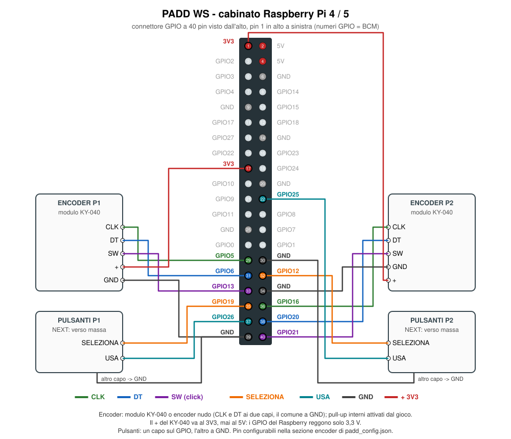
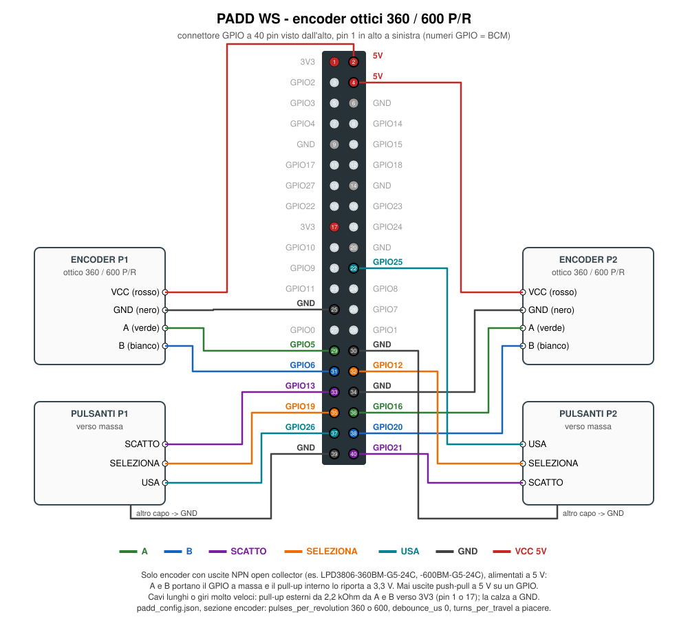

# Installazione su Raspberry Pi

Testato come target: Raspberry Pi 4/5 con Raspberry Pi OS (desktop, X11); per gli altri modelli vedi sotto.
Sul cabinato gira la versione Python oppure la versione Rust: hanno lo stesso
`padd_config.json` e un servizio systemd ciascuna, e se ne abilita uno solo.

| | Python | Rust |
|---|---|---|
| modalità | Classic, EVO | Classic, EVO, NEXT, contro la CPU |
| encoder | demone pigpio (non c'è sul Pi 5) | GPIO del kernel, Pi 4 e Pi 5, nessun demone |
| pulsanti di NEXT | – | SELEZIONA e USA per giocatore |
| servizio | `paddws.service` | `paddws-rust.service` |

## Modelli

La versione Rust usa l'eseguibile `linux-aarch64` della release, che richiede Raspberry Pi OS **a
64 bit** (Bookworm o successivo).

| modello | versione Rust | note |
|---|---|---|
| Pi 5, Pi 4, Pi 400 | sì | il target principale |
| Pi 3, 3B+, 3A+, Zero 2 W | sì, con il sistema a 64 bit | grafica VideoCore IV (OpenGL 2.1): basta al gioco, meglio tenere spento il filtro CRT; non ancora provato su un Pi 3 vero |
| Pi 2 v1.2 (BCM2837, come il Pi 3) | sì, con il sistema a 64 bit | come il Pi 3 |
| Pi 2 v1.1 (BCM2836) | no | processore solo a 32 bit: servirebbe un eseguibile `armv7` a 32 bit, che oggi non c'è (anche per chi usa il Pi 3 con il sistema a 32 bit) |
| Pi 1, Zero, Zero W | no | troppo vecchi (ARMv6) |

La revisione del Pi 2 è scritta sulla scheda ("V1.1" o "V1.2"); da terminale,
`cat /proc/device-tree/model` scrive per esteso modello e revisione (per esempio "Raspberry Pi 2
Model B Rev 1.1"). Per sapere se il sistema è a 64 bit: `uname -m` risponde `aarch64` (64 bit)
oppure `armv7l` (32 bit). Gli encoder si leggono dai GPIO del kernel su tutti i modelli.

## Collegamenti

La versione Rust accetta due tipi di encoder, con lo stesso programma: meccanici a scatti come il
KY-040 (20 scatti per giro, con pulsante) oppure ottici da 360 o 600 impulsi per giro (senza scatti
né pulsante: lo scatto in avanti va su un pulsante arcade a parte, sullo stesso GPIO dello SW). I
pin sono gli stessi; cambiano alimentazione e pulsanti.

### Encoder KY-040



| | CLK | DT | SW (click) | SELEZIONA | USA | GND | + |
|---|---|---|---|---|---|---|---|
| giocatore 1 | GPIO5 (pin 29) | GPIO6 (pin 31) | GPIO13 (pin 33) | GPIO19 (pin 35) | GPIO26 (pin 37) | pin 39 | 3V3 (pin 17) |
| giocatore 2 | GPIO16 (pin 36) | GPIO20 (pin 38) | GPIO21 (pin 40) | GPIO12 (pin 32) | GPIO25 (pin 22) | pin 34, 30 | 3V3 (pin 1) |

- Encoder: modulo KY-040 o encoder nudo (CLK e DT ai due capi esterni, il comune a GND). La
  versione Rust attiva i pull-up interni su tutte le linee, quindi anche un encoder nudo funziona.
- Il `+` del KY-040 va al **3V3, mai al 5V**: i GPIO del Raspberry reggono solo 3,3 V.
- Pulsanti (SW dell'encoder, SELEZIONA, USA): un capo sul GPIO, l'altro a GND.
- I pin si cambiano nella sezione `encoder` di `padd_config.json` (numeri GPIO, cioè BCM):
  `e1_clock_pin`, `e1_data_pin`, `e1_switch_pin`, `e2_...` come nella versione Python, più
  `e1_select_pin`, `e1_activate_pin`, `e2_select_pin`, `e2_activate_pin` (solo Rust; un numero
  negativo = pulsante assente). Senza le chiavi nuove valgono i pin dello schema.

### Encoder ottici 360 / 600 P/R



| | A (verde) | B (bianco) | VCC (rosso) | GND (nero) | SCATTO | SELEZIONA | USA |
|---|---|---|---|---|---|---|---|
| giocatore 1 | GPIO5 (pin 29) | GPIO6 (pin 31) | 5V (pin 2) | pin 25 (pulsanti: 39) | GPIO13 (pin 33) | GPIO19 (pin 35) | GPIO26 (pin 37) |
| giocatore 2 | GPIO16 (pin 36) | GPIO20 (pin 38) | 5V (pin 4) | pin 34 (pulsanti: 30) | GPIO21 (pin 40) | GPIO12 (pin 32) | GPIO25 (pin 22) |

- Solo encoder con uscite **NPN open collector** (per esempio LPD3806-360BM-G5-24C e
  -600BM-G5-24C; i colori dei fili sono quelli tipici di questi modelli): alimentati a 5 V, le
  uscite A e B portano il GPIO verso massa e il pull-up interno lo riporta a 3,3 V, quindi sul
  Raspberry non arrivano mai 5 V. Un encoder con uscite push-pull (in tensione) alimentato a 5 V
  va collegato con un adattatore di livello: 5 V su un GPIO lo danneggiano.
- Con cavi lunghi o se si gira molto veloce: pull-up esterni da 2,2 kΩ da A e da B verso il 3V3
  (pin 1 o 17). La calza del cavo, se c'è, va a GND.
- In `padd_config.json`, sezione `encoder`: `"pulses_per_revolution": 360` (o `600`) e
  `"debounce_us": 0` (l'antirimbalzo serve solo ai contatti meccanici e taglierebbe i fronti veri).

| chiave | default | |
|---|---|---|
| `pulses_per_revolution` | `20` | impulsi per giro: fino a 30 l'encoder è a scatti (KY-040), oltre conta ogni transizione |
| `turns_per_travel` | `1.0` | giri di manopola per portare la racchetta da un bordo all'altro (`0.5` = mezzo giro) |
| `debounce_us` | `500` | antirimbalzo in microsecondi; `0` per gli encoder ottici |

### Comandi

Comandi con gli encoder: rotazione = racchetta (un giro per tutta la corsa), click = scatto in avanti,
pressione lunga (1,5 s) = menu; nel menu la rotazione sceglie (una voce ogni ventesimo di giro) e
il click conferma; nell'attract il click vale come Start. Con gli encoder ottici il click è il
pulsante SCATTO. In NEXT: SELEZIONA passa al bonus successivo della riserva, USA lo attiva;
con STEER la manopola girata lontano dalla racchetta (ferma) guida la palla.

## Versione Rust

```sh
# dall'ultima release: paddws-X.Y.Z-linux-aarch64.tar.gz (Raspberry Pi OS a 64 bit)
mkdir -p /home/pi/paddws-rust
tar xzf paddws-*-linux-aarch64.tar.gz --strip-components=1 -C /home/pi/paddws-rust
```

In `/home/pi/paddws-rust/padd_config.json` impostare `"encoder": {"enabled": true, ...}`. Poi:

```sh
sudo cp deploy/raspberry/paddws-rust.service /etc/systemd/system/
sudo systemctl daemon-reload
sudo systemctl disable --now paddws.service     # se era attiva la versione Python
sudo systemctl enable --now paddws-rust.service
journalctl -u paddws-rust.service -f            # log: "Encoders on GPIO [...]" se gli encoder sono attivi
```

Per tornare alla versione Python: `disable --now paddws-rust.service` ed `enable --now
paddws.service`. Il gioco legge il file accanto all'eseguibile; la voce SHUTDOWN del menu
compare solo su Raspberry Pi ed esegue `sudo shutdown -h now`.

## Versione Python

```sh
sudo apt install python3-venv pigpio
sudo systemctl enable --now pigpiod        # solo se si usano gli encoder
git clone <repo> /home/pi/PaddWS            # oppure copiare la cartella
cd /home/pi/PaddWS
python3 -m venv .venv
.venv/bin/pip install -e ".[pi]"
```

In `padd_config.json` impostare `"encoder": {"enabled": true, ...}` con i pin corretti (gli
stessi dello schema; i pulsanti SELEZIONA e USA la versione Python non li usa).

Avvio automatico:

```sh
sudo cp deploy/raspberry/paddws.service /etc/systemd/system/
sudo systemctl daemon-reload
sudo systemctl enable paddws.service
sudo systemctl start paddws.service
sudo systemctl status paddws.service      # verifica
```

## Note

- Entrambi i servizi richiedono il login automatico nel desktop (`raspi-config` → System → Boot /
  Auto login). Su Raspberry Pi OS con Wayland i giochi usano XWayland; se lo schermo resta nero,
  passare a X11 (`raspi-config` → Advanced Options → Wayland → X11).
- Boot silenzioso: `boot/cmdline.txt` e `boot/config.txt` sono la configurazione usata sul
  cabinato (splash e cursore disattivati); riferimento: `boot/info.txt`.
- Il filtro CRT della versione Python usa uno shader GLSL desktop: se il driver GLES non lo
  compila viene disattivato automaticamente (vedi log `CRT filter unavailable`).
