# How to play

[← README](../../README.en.md) · [ Italiano](../it/come-si-gioca.md) · [ **English**](how-to-play.md)

- [Attract mode and matches](#attract-mode-and-matches)
- [Modes](#modes) and [NEXT power-ups](#next-power-ups)
- [Paddle types](#paddle-types-next)
- [Special moves](#special-moves-next)
- [CHALLENGE](#challenge)
- [Sound](#sound)
- [Controls](#controls)
- [Features by version](#features-by-version)
- [Screenshots](#screenshots)

## Attract mode and matches

At power-on the attract mode starts: self-test, stripes, logo and title with the ball bouncing off
everything that is black, the CHALLENGE high-score table and a demo match, CPU against CPU, in the
chosen mode (in the menu on PC, in the OSD on the MiSTer), with the mode name in the middle. In
NEXT power-ups and paddles are random; in CHALLENGE you see the opponent of a random level.

With a coin, or in Free Play, Start opens the menu (on the MiSTer it starts the match right away
with the OSD options); each match costs one credit, even with two players. The match begins after a
3-second countdown. The menu sets the mode (**GAME TYPE**), the players (**PLAYERS**: TWO, VS CPU,
CHALLENGE, ONE), difficulty, volumes and the other options; the choices are kept for next time. The
first time, the game starts in NEXT with PLAYERS: CHALLENGE (on the MiSTer *Game type: Challenge*,
on the C64 at every power-on). If you go back to the menu during a match, **RESUME** picks it up
again.

## Modes

- **CLASSIC**: classic Pong, 1 or 2 players. With two players, the first to 11 wins; in
  single-player you play against a wall with 3 balls, each bounce scores a point and `TOP` is the
  record.
- **EVO** (2 players): hitting the ball with the grey area in the middle of the paddle powers it up
  (the area shrinks with each boost); the forward dash intercepts the ball and sends it back.
- **NEXT** (2 players or against the CPU): Classic with the forward dash and power-ups. Before the
  match each player picks 3 power-ups out of 6 and a paddle; capsules start from the centre line
  and are collected by touching them with the paddle, then the power-ups are selected and activated
  from the reserve at the top.
- **VS CPU**: alone against the computer, in every mode (menu **PLAYERS: VS CPU**); the CPU's skill
  follows the difficulty.
- **CHALLENGE**: the ladder against 7 opponents, see [below](#challenge).

### NEXT power-ups

Each capsule shows the symbol of its power-up:

| power-up | effect |
|:---:|---|
|  **TELEPORT** | when the incoming ball crosses the half-way line, the paddle enters a portal and comes out of another one where the ball will arrive, in time to catch it |
|  **SMASH** | the next shot is faster and angled, away from the opponent |
| 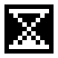 **SLOW** | the ball loses a third of its speed until the player who used it hits it: then it goes back to the speed it had before |
|  **CURVE** | the next shot curves, and the curve flips at each bounce |
|  **GHOST** | after the next shot the ball is only visible in flashes |
|  **STEER** | after the next shot, up and down steer the ball, with limited steering, up to 3/4 of the field (marked in yellow on the edges); meanwhile the paddle stays still |
|  **SUPER** | rare, only from capsules: a very fast shot, with a random animation among spinning paddle, hit-stop and a comet that breaks the net |
| 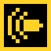 **BULLET** | rare, only from capsules (about one in 16): defensive bullet time. Once activated it stays armed (the yellow border of the paddle flashes) until the ball enters your own half, heading towards you; then, easing in, everything runs at half speed (ball with CURVE and STEER, opponent's paddle, capsules, the opponent's BLASTER shots) except your own paddle, until the return or the point. The rest of the game turns grey and blurred (on the MiSTer with soft edges, on the C64 just grey) and the ball leaves a trail of images. If you concede a point before it triggers, the power-up is not used up; only one can be used at a time |

## Paddle types (NEXT)

After the power-ups each player picks a paddle (the CPU picks at random; in CHALLENGE each opponent
has its own). Each type has an advantage, a small price and a mark that makes it recognisable in
play (in yellow in the picture, with the paddles to scale). The types are balanced so that each
wins about half of the points against the normal paddle.

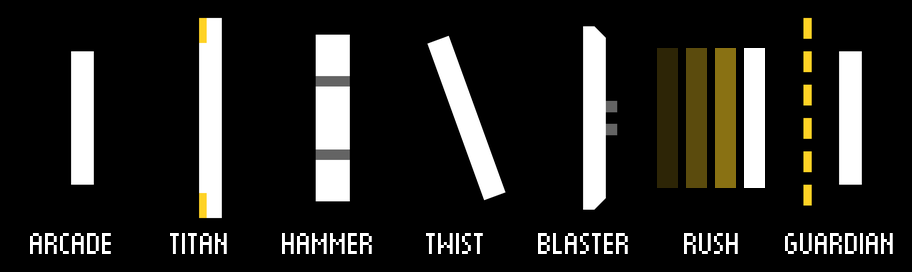

| type | advantage | price |
|---|---|---|
| **ARCADE** | more capsules: they start every 3-4 s instead of 4-5 and two out of three go to it (if the opponent is not ARCADE); shorter pause between two power-ups | shorter (0.8) |
| **TITAN** | taller (1.2) | slower (0.8) |
| **HAMMER** | shots leave faster (×1.25, if the ball doesn't already have a boost) | slow (0.75) |
| **TWIST** | passes half of its vertical speed to the ball: hitting while moving gives angle; it tilts with its speed | — |
| **BLASTER** | slightly taller (1.1) and it shoots: a magazine of 4 fast shots that can be fired in a row, shown as small yellow rectangles behind the paddle (it reloads 3 s after the first shot); the shots collect capsules, even those heading for the opponent | no forward dash: that button shoots |
| **RUSH** | longer forward dash (×1.5), which catches the ball more often; from the forward position shots leave faster (×1.15, also with the dash that intercepts the ball) and closer to the opponent; the forward paddle is also quicker (×1.15) | shorter (0.85) |
| **GUARDIAN** | a 5-section wall behind the paddle, one per match: each missed ball bounces off the section at the ball's height, which then disappears | shorter (0.8) |

With the encoder (or with paddles and spinners on the MiSTer) the slower types follow the knob, but
with a top speed. The values are in the `next.paddles` section of the
[configuration](configuration.md).

## Special moves (NEXT)

Fighting-game moves performed with a gesture on the controller. They are always on in NEXT matches,
in CHALLENGE and in the attract mode demo; they are the same for every paddle type. Before the
match, the **HOW TO PLAY** screen, in pixel art like the Neo Geo games, introduces them: the command
for the controller in use (keyboard, gamepad or arcade stick, cabinet spinner, mouse or touch)
lights up step by step, the ball leaves with the effect of the move, and below are the cost and the
power-up controls. Start (or a click, or a tap) skips it; in CHALLENGE it only appears before the
first level.

The meter next to the reserve fills up as you play: a little with each hit, twice as much with a
dash that intercepts the ball, more when you concede a point; it isn't emptied between points. The
meter has two sections and a move spends as many as are full: with half a meter you get the normal
move, with a full meter the stronger **MAX**. You can use it straight away or wait for the MAX,
risking that the right ball doesn't come back. When a move is ready the meter turns yellow. One move
at a time, not during the serve and not with a power-up armed (and while a move is armed no
power-ups can be activated).

| move | effect |
|---|---|
| **STRAIGHT SHOT** | the next shot goes straight, with no angle, at one and a half times the push of the hit (twice with the MAX); it lasts one shot only, and is lost if the opponent intercepts it with the dash |
| **RISING STRIKE** | the next shot goes straight and, past 5/8 of the field (7/8 with the MAX), suddenly rises at 45° away from the opponent's paddle: it fools whoever had already moved into its path |

A move never leaves slowly, even at the start of a rally: when it is hit, the ball goes at least at
half the difficulty's top speed with STRAIGHT SHOT (so the MAX at least at the top speed) and at 3/8
with RISING STRIKE.

| command | STRAIGHT SHOT | RISING STRIKE |
|---|---|---|
| keyboard | down, up + dash | up, down + dash |
| joystick (MiSTer, gamepad and arcade stick on PC, Raspberry and web) | ↓ ↘ → + **A** (→ = towards the opponent) | → ↓ ↘ + **A** |
| joystick (C64) | ↓ ↘ → + fire (→ = towards the opponent) | → ↓ ↘ + fire |
| encoder, paddle, spinner | the knob turns quickly down and back up, then click (**A**) | turns quickly up and back down, then click (**A**) |
| mouse as a spinner (PC and web) | the mouse moves quickly down and back up, then left click | moves quickly up and back down, then left click |
| touch (phones and tablets) | the finger moving the paddle slides quickly down the screen and back up, then a tap with a second finger | the same finger slides quickly up and back down, then a tap with a second finger |

The directions must come within 0.3 s of each other and the dash within 0.25 s of the last one.
The dash that ends the gesture only becomes the move if the move can start; otherwise it stays a
normal dash. The CPU uses the moves too, when it is already on the ball, and usually waits for the
MAX; when a RISING STRIKE rises, the CPU needs its reaction time to notice, just like a person.

On the C64 the fire that ends the quarter-circle uses the move if it can start, otherwise the
selected power-up (the dash is the joystick towards the opponent); with paddles there are no
gestures, the attract mode demo stays EVO and there is no HOW TO PLAY screen. The meter, the icon of
the armed move, the "P1 MAX STRAIGHT SHOT!" caption and the sounds are there, the shouted voices are
not (see [c64/README.md](../../c64/README.md), in Italian).

## CHALLENGE

Alone against 7 CPU opponents (menu **PLAYERS: CHALLENGE**, on the MiSTer OSD *Game type:
Challenge*). You pick power-ups and paddle once, then each level introduces its opponent: a
different paddle type for each level, its 3 power-ups and an ever stronger CPU, from the ARCADE of
the first level to the GUARDIAN of the final boss. Matches are NEXT, to 5 points.

- **Arcade scoring**: hits, successful dashes, SUPERs and points scored, with a multiplier that
  rises in long rallies (up to ×8); for each level won a prize, plus a double prize for a perfect
  match, if the opponent didn't score.
- **Continue**: after losing a level, 10 seconds to insert a coin (or press Start in Free Play) and
  try the same level again, with the score reset.
- **High-score table**: the top 10 with initials, also shown in the attract mode. On PC it is saved
  in `padd_scores.json` next to the configuration, in the browser in `localStorage`, on the C64 in
  the cartridge flash; on the MiSTer on the SD card (`PaddWS.nvm`, automatically with the OSD
  option *Autosave scores* or with *Save settings*), if the core is started from the `.mra`.
- **New challenger**: during the introduction of a level, the match against
  the CPU or the level cleared screen, a second player with a credit (or in Free Play) presses their
  Start (on PC `2`, or `1` if the champion plays on the right) and **HERE COMES A NEW CHALLENGER!**
  appears. On touch screens they hold a finger for a second on the free half, and during the match
  behind the CPU's paddle, where it says P2 HOLD HERE. The challenger picks power-ups and paddle and
  they play a duel to 5 points: the winner resumes the level against the CPU from their side, with a
  prize equal to the level's (the champion adds it to their score, the challenger starts from it);
  the loser enters their initials if they make the table.
- **Ending**: after beating the last opponent come CONGRATULATIONS and the voice "YOU WIN!", the
  parade of the seven opponents with the DEFEATED stamp, the final score with the champion's prize
  (the win of the last level, plus the perfect match), "YOU ARE THE PADD WS CHAMPION" with
  fireworks, the credits and THE END, in about a minute, with its own music; then the initials.
  Start skips it. The voice "YOU WIN!" is also heard at every match won against the CPU. If the
  winner didn't let the opponent score a single point, PERFECT replaces YOU WIN (or GAME OVER, with
  two players), shouted by the voice (not on the C64).
- **Voice**: in the introduction a digitised "SID-style" voice announces the opponent's name (on the
  C64 and MiSTer with the trick of the SID volume register; on the C64 from the cartridge).
- **Opponent themes**: in the match against the CPU each opponent has its own theme, on the first
  two SID voices (the third is left for the effects). They are turned off with **MUSIC VOLUME: 0%**
  in the menu (on the MiSTer *Music volume: 0%*, which turns off all music); on the C64 the theme
  comes with the voice, from the cartridge.

The ladder is tuned for an average player with a joystick (they almost always win the first level,
and beat the boss about one time in four); the difficulty in the menu changes the ball speed: with a
spinner or paddles, HARD or EXPERT is a better choice.

## Sound

Sounds and music go through a **SID** (the Commodore 64 sound chip): on the MiSTer it is the one of
the C64 core (OSD *Sound*: SID 8580 or SID 6581); on PC, Raspberry and web the music is played in
real time by a SID written in Rust with the same player (`rust/sid`), the effects are recorded from
the simulated core.

- **MUSIC VOLUME** and **EFFECTS VOLUME** (PC, Raspberry and web; on the MiSTer *Music volume* and
  *Effects volume* in the OSD) set music and effects (voices included) from 0% to 100%, in 10%
  steps: right and left raise and lower them, confirm (Enter, tap, click) raises them and after
  100% goes back to 0%. With the music at 0% no song plays. The music volume changes at once, also
  for the song that is playing; when you change the effects volume you hear a hit at the new volume.
- On the C64 there is a single **VOLUME**, for music and effects together (the SID has a single
  volume register), from 0% to 100% in 10% steps; the digitised voices stay at their own level.
- **ATTRACT SOUND: OFF** silences the attract mode, music included, and also turns off the music of
  the menu and of the power-up and paddle picks.
- In the browser, phones and tablets included, the volumes are the same as on PC: you lower them
  from the menu.

The music is original: title, level introduction, level cleared, continue, game over, champion and
ending; during matches only effects, except in CHALLENGE, where each opponent has its own theme. The
theme speeds up at match point (×1.25, same notes) and in bullet time slows down by an octave, like
a tape at half speed. Some songs use the SID filter (the HAMMER bass, the title, TITAN, the ending)
and are meant for the 8580.

## Controls

### PC (Windows and Linux)

| | left player | right player |
|---|---|---|
| up / down | `W` / `S` | `↑` / `↓` |
| forward dash (EVO, NEXT) | `D` | `←` |
| NEXT: select / activate the power-up | `F` / `C` | `.` / `-` |
| NEXT: STRAIGHT SHOT / RISING STRIKE | `S` `W` + `D` / `W` `S` + `D` | `↓` `↑` + `←` / `↑` `↓` + `←` |
| mouse as a spinner (option) | vertical movement = position, left = dash, right / middle = select / use the power-up | — |

Double tap up or down = fast acceleration. `5` coin, `Enter` / `Space` / `1` Start, `P` pause,
`Esc` menu and quit, `F11` full screen, `C` CRT filter (not during NEXT).
The menu is a wheel: `↑` / `↓` turn it (the selected item stays in the middle, in yellow), `←` /
`→` change the value, `Enter` confirms.

**Gamepads and arcade sticks** (PC, Raspberry and web): the first one connected belongs to the left
player, the second to the right one; if you play alone with a single gamepad, it is yours. Stick or
d-pad to move (the analog stick with diagonals, for the moves), **A** dash and special moves, **B**
selects and **C** (X or Y) uses the power-up, as in the HOW TO PLAY; **Start** pause and Start,
**Select** coin. In the menus you use the directions, **A** confirms and **B** goes back; in pause
**A** resumes and **B** goes back to the menu. USB arcade sticks and cabinet encoder boards, which
have no analog stick, work too (see [rust/README.md](../../rust/README.md#gamepad-e-stick-arcade),
in Italian).

**Mouse as a spinner** (PC and web, menu **MOUSE SPINNER: ON** or `mouse.spinner` in the
configuration, off by default): the mouse becomes the left player's knob, like the cabinet's
encoder. The cursor stays captured in the window (on Windows it is released when the window goes to
the background) and the vertical movement takes the paddle to the matching height:
`mouse.travel_pixels` pixels of mouse for the whole travel. Left click = forward dash (and Start,
confirm in the menu), right = select the power-up, middle (wheel) = use the power-up; special moves
as with the spinner. In the menus the movement picks the item and the click uses it. The right
player stays on the keyboard. In the browser the cursor is captured with Pointer Lock after the
first click on the page; `Esc` releases it and another click captures it again.

### Raspberry Pi cabinet

Rotary encoders: rotation = paddle position, click = dash, long click = menu; in the menu the knob
turns the wheel. Wiring in [deploy/raspberry/README.en.md](../../deploy/raspberry/README.en.md).

### Phones and tablets

The web version, in landscape (in portrait it asks you to rotate the device). Alone or against the
CPU the whole screen belongs to the player; with two players each has their own half.

- the paddle follows the finger, at the finger's height; with STEER, a finger above or below the
  still paddle steers the ball;
- a second finger, while the first one holds the paddle, does the forward dash;
- special moves: the paddle finger slides quickly down and back up (or up and back down), then a tap
  with the second finger;
- NEXT: a tap on a capsule in your reserve at the top uses that power-up straight away;
- menu: drag the wheel with your finger, a tap on the item in the middle changes or uses it;
- power-up pick: tap the three power-ups (another tap removes them), then OK at the top of the
  column;
- paddle pick: a tap shows it, a second tap on the same row picks it;
- in the attract mode a tap counts as Start;
- pause: a tap on the ❚❚ symbol at the top of the centre line; in pause tap to resume or tap MENU
  (in the menu RESUME picks up the match);
- CHALLENGE: the challenger joins by holding a finger for a second behind the CPU's paddle (P2 HOLD
  HERE).

The first tap goes full screen (Android, iPad) and the screen stays on; on iPhone, full screen is
obtained with *Share → Add to Home Screen* (on Android also with *Install app*). Audio starts at
the first tap. In a desktop browser the mouse acts as a finger (or as a spinner) and keyboard and
gamepad work as on PC. Menu preferences and the high-score table are kept in the browser
(`localStorage`).

On a phone screen the ball and paddles are thin: **ZOOM** in the menu (125% or 150%) makes them
thicker; the playfield and the paddle height stay the same.

### MiSTer

Joystick up/down (or paddle or spinner), **A** forward dash, **B** fast, **X** / **Y** select and use
the power-up (NEXT), **Start**, **Select** coin; on the keyboard `5` and `1`. The special moves are
done with joystick quarter-circles + **A**. The options (mode, players, Free Play, difficulty,
scores upright or facing the players, attract sound, SID 8580 or 6581, music and effects volumes,
high-score saving, white level, joystick, paddle or spinner and its speed) are in the OSD. Details
in [mister/README.md](../../mister/README.md) (in Italian).

### Commodore 64

A version in 6502 assembly that plays the same match as the Rust core, bit for bit: one tick per
frame at 50 Hz, a 320×200 pixel playfield, music and effects on the real SID. The EasyFlash
cartridge `paddws.crt` (C64 Ultimate, a real EasyFlash written with EasyProg, VICE): everything in
one file, instant start and the CHALLENGE voice without loading; the high-score table is saved in
the cartridge flash and survives power-off (in VICE with `-easyflashcrtwrite`).

Joysticks in port 2 (left) and 1 (right), or a pair of paddles in port 1. Up and down move the
paddle, the joystick towards the opponent does the forward dash (and shoots with the BLASTER); fire
in NEXT uses the selected power-up, which changes by itself every second among those in the reserve,
and in EVO does the forward dash. With paddles the button dashes, and power-ups are selected and
used with `F` / `C` (left) and `.` / `-` (right). Key **5** coin, fire or **RETURN** Start,
**RUN/STOP** pause, **Q** menu. PAL only; so far tested in VICE. Details in
[c64/README.md](../../c64/README.md) (in Italian).

## Features by version

| | Rust (PC, Raspberry, web) | MiSTer | Commodore 64 | Python |
|---|:---:|:---:|:---:|:---:|
| CLASSIC (1 or 2 players) and EVO | ✓ | ✓ | ✓ | ✓ |
| against the CPU | ✓ | ✓ | ✓ | — |
| NEXT, power-ups and paddle types | ✓ | ✓ | ✓ | — |
| special moves | ✓ | ✓ | ✓ (joystick) | — |
| HOW TO PLAY | ✓ | ✓ | ✓ (joystick) | — |
| CHALLENGE, high scores and new challenger | ✓ | ✓ | ✓ | — |
| attract mode demo | chosen mode | chosen mode | EVO | — |
| SID music | SID in Rust | SID of the C64 core | real SID | — |
| "SID-style" voices | ✓ | ✓ | opponent's name, READY?, GO! and YOU WIN! | — |
| CRT filter | ✓ | 15 kHz output | — | ✓ |
| ZOOM (thicker ball and paddles) | ✓ | — | — | — |
| controls | keyboard, gamepad, mouse, encoder, touch | joystick, paddle, spinner | joystick, paddle | keyboard, encoder |

## Screenshots

| | |
|---|---|
| 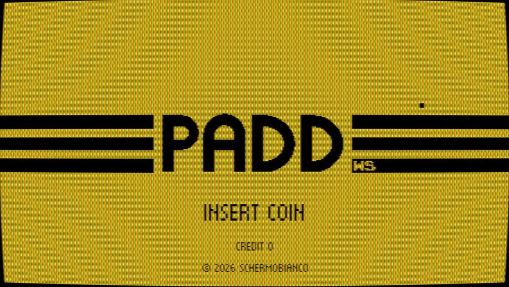 | 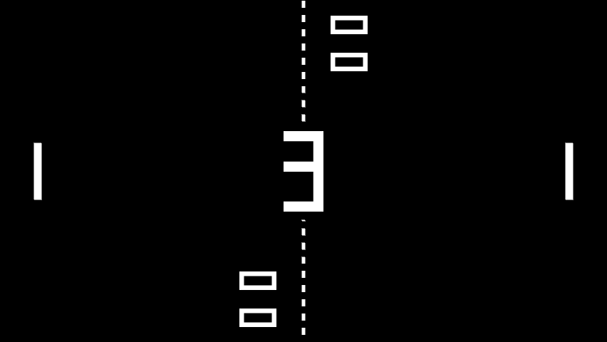 |
| Attract mode title, with the CRT filter | Countdown before the serve |
| 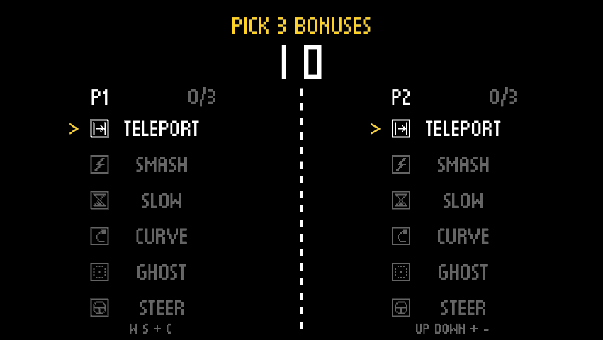 | 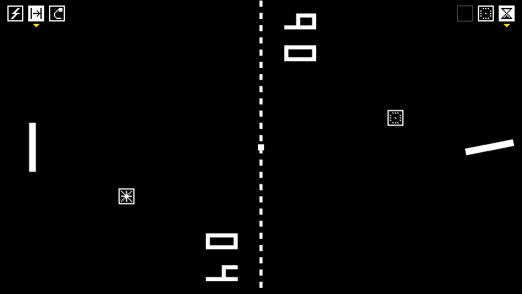 |
| NEXT: each player picks 3 power-ups out of 6 | NEXT: reserves at the top, capsules in flight, paddle spinning with the SUPER |
| 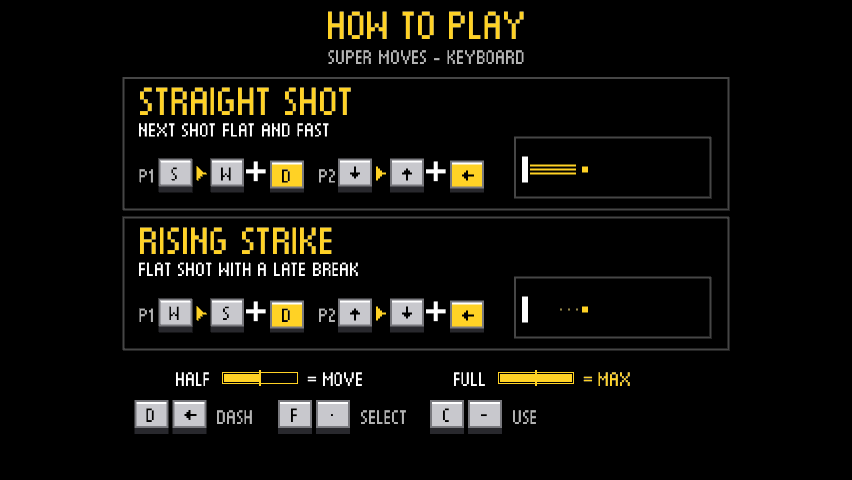 | 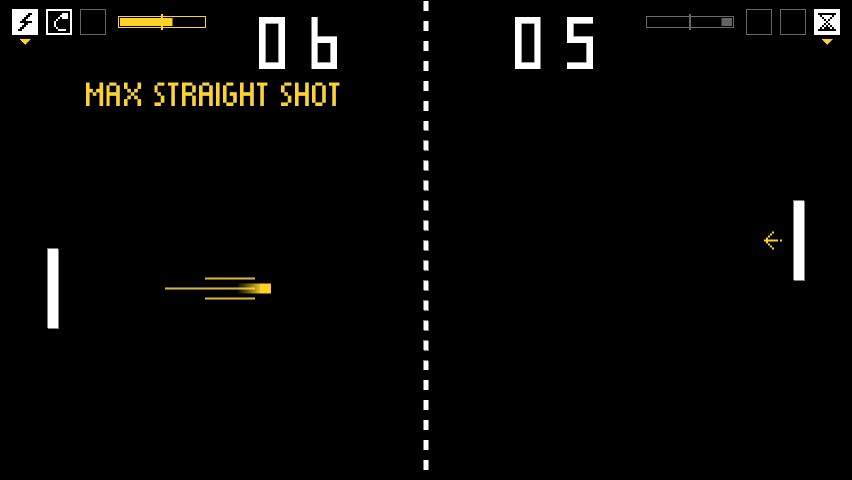 |
| NEXT: HOW TO PLAY, the special moves before the match | NEXT: move meters next to the reserves, STRAIGHT SHOT in flight |
| 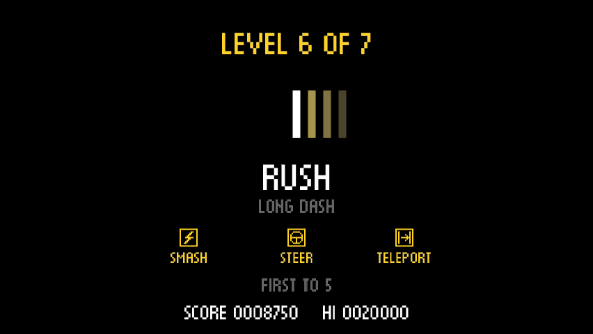 | 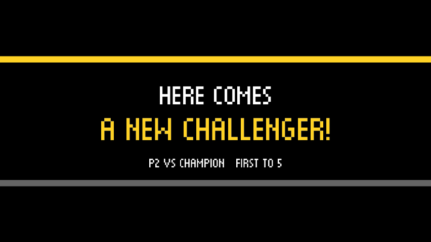 |
| CHALLENGE: introduction of the sixth opponent, RUSH | CHALLENGE: a second player joins in |
| 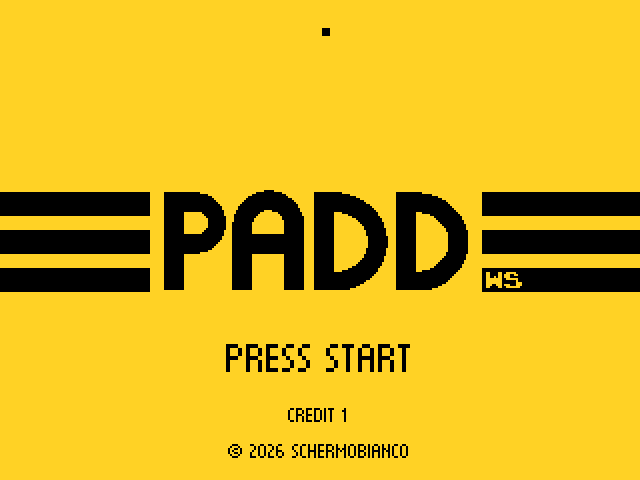 | 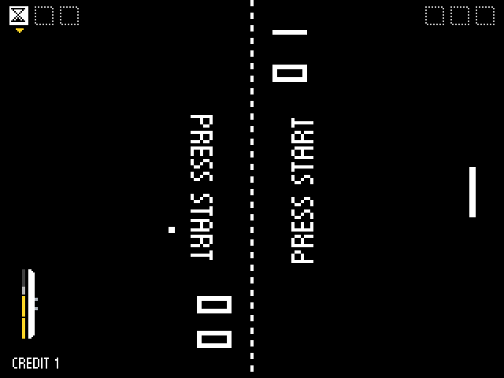 |
| MiSTer core at 320×240: title after the coin | MiSTer core: CPU against CPU demo of the chosen mode (here NEXT) |
| 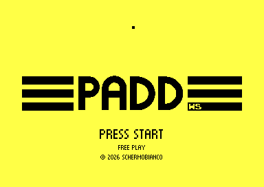 | 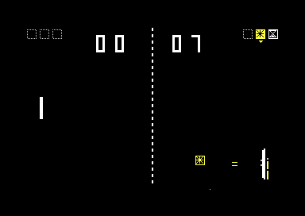 |
| Commodore 64: title in Free Play | Commodore 64: NEXT against the CPU, with the CURVE capsule |
| 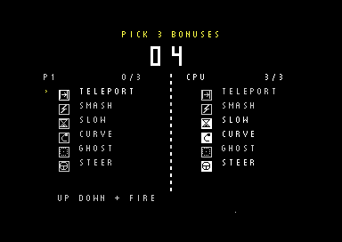 | 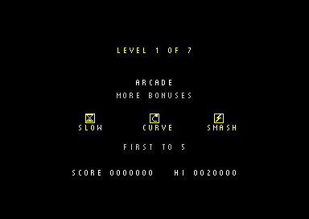 |
| Commodore 64: power-up pick (the CPU has already picked) | Commodore 64: introduction of the first CHALLENGE opponent |

The PC screenshots come from `paddws --screenshot-tour DIR` (Rust version), the MiSTer ones from the
simulation of the core with Verilator (`mister/sim/frames`), the C64 ones from VICE
(`c64/shot.ps1`).
