# Come si gioca

[← README](../../README.md) · [ **Italiano**](come-si-gioca.md) · [ English](../en/how-to-play.md)

- [L'attract e la partita](#lattract-e-la-partita)
- [Modalità](#modalità) e [bonus di NEXT](#bonus-di-next)
- [Tipi di racchetta](#tipi-di-racchetta-next)
- [Mosse speciali](#mosse-speciali-next)
- [CHALLENGE](#challenge)
- [Suono](#suono)
- [Comandi](#comandi)
- [Funzioni per versione](#funzioni-per-versione)
- [Schermate](#schermate)

## L'attract e la partita

All'accensione parte l'attract: auto-test, strisce, logo e titolo con la pallina che rimbalza su
tutto ciò che è nero, la classifica di CHALLENGE e una partita dimostrativa, CPU contro CPU, nella
modalità scelta (nel menu sul PC, nell'OSD sul MiSTer), con il nome della modalità al centro. In
NEXT bonus e racchette sono a caso; in CHALLENGE si vede l'avversario di un livello a caso.

Con un gettone, o in Free Play, Start apre il menu (sul MiSTer avvia subito la partita con le
opzioni dell'OSD); ogni partita costa un credito, anche in due. La partita comincia dopo un conto
alla rovescia di 3 secondi. Dal menu si scelgono modalità (**GAME TYPE**), giocatori
(**PLAYERS**: TWO, VS CPU, CHALLENGE, ONE), difficoltà, volumi e le altre opzioni; le scelte
restano per la volta dopo. La prima volta il gioco parte in NEXT con PLAYERS: CHALLENGE (sul
MiSTer *Game type: Challenge*, sul C64 a ogni accensione). Se si torna al menu durante una
partita, **RESUME** la riprende.

## Modalità

- **CLASSIC**: Pong classico, 1 o 2 giocatori. In due vince chi arriva per primo a 11; in singolo
  si gioca contro un muro con 3 palle, ogni rimbalzo vale un punto e `TOP` è il record.
- **EVO** (2 giocatori): colpire la palla nell'area grigia al centro della racchetta la potenzia
  (l'area si restringe a ogni boost); lo scatto in avanti intercetta la palla e la rilancia.
- **NEXT** (2 giocatori o contro la CPU): Classic con lo scatto in avanti e i bonus. Prima della
  partita ognuno sceglie 3 bonus su 6 e la sua racchetta; le capsule partono dalla mezzeria e si
  raccolgono toccandole con la racchetta, poi si scelgono e si attivano dalla riserva in alto.
- **VS CPU**: da soli contro il computer, in tutte le modalità (menu **PLAYERS: VS CPU**); la
  bravura della CPU segue la difficoltà.
- **CHALLENGE**: la scalata contro 7 avversari, vedi [sotto](#challenge).

### Bonus di NEXT

Ogni capsula mostra il simbolo del suo bonus:

| bonus | effetto |
|:---:|---|
|  **TELEPORT** | quando la palla in arrivo supera la metà campo, la racchetta entra in un portale ed esce da un altro nel punto in cui arriverà la palla, in tempo per prenderla |
|  **SMASH** | il prossimo tiro parte più veloce e angolato, lontano dall'avversario |
| 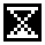 **SLOW** | la palla perde un terzo della velocità finché chi l'ha usato non la colpisce: allora riparte alla velocità di prima |
|  **CURVE** | il prossimo tiro curva, e la curva si inverte a ogni rimbalzo |
|  **GHOST** | dopo il prossimo tiro la palla si vede solo a lampi |
| 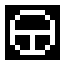 **STEER** | dopo il prossimo tiro i comandi su e giù guidano la palla, con una sterzata limitata, fino a 3/4 del campo (segnati in giallo sui bordi); intanto la racchetta resta ferma |
| 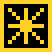 **SUPER** | raro, solo dalle capsule: tiro velocissimo, con un'animazione a caso tra racchetta che ruota, hit-stop e cometa che spacca la rete |
| 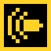 **BULLET** | raro, solo dalle capsule (circa una su 16): bullet time difensivo. Una volta attivato resta armato (il bordo giallo della racchetta lampeggia) finché la palla non entra nella propria metà campo, diretta verso di sé; allora, con un'entrata graduale, tutto va a metà velocità (palla con CURVE e STEER, racchetta avversaria, capsule, colpi del BLASTER avversario) tranne la propria racchetta, fino alla ribattuta o al punto. Il resto del gioco diventa grigio e sfocato (sul MiSTer con bordi sfumati, sul C64 solo grigio) e la palla lascia una scia di immagini. Se si subisce un punto prima che scatti, il bonus non si consuma; se ne usa uno alla volta |

## Tipi di racchetta (NEXT)

Dopo i bonus ognuno sceglie la sua racchetta (la CPU a caso; in CHALLENGE ogni avversario ha la
sua). Ogni tipo ha un vantaggio, un piccolo prezzo e un segno che lo fa riconoscere in partita (in
giallo nell'immagine, con le racchette in proporzione). I tipi sono bilanciati perché ognuno vinca
circa metà dei punti contro la racchetta normale.

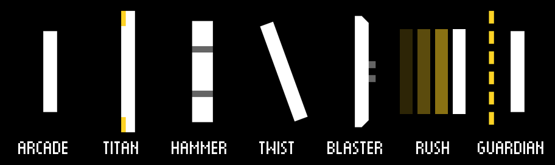

| tipo | vantaggio | prezzo |
|---|---|---|
| **ARCADE** | più capsule: partono ogni 3-4 s invece di 4-5 e due su tre vanno a lui (se l'avversario non è ARCADE); pausa più breve tra due bonus | più corta (0,8) |
| **TITAN** | più alta (1,2) | più lenta (0,8) |
| **HAMMER** | i tiri partono più veloci (×1,25, se la palla non ha già un boost) | lenta (0,75) |
| **TWIST** | passa alla palla metà della sua velocità verticale: colpendo in movimento si dà angolo; si inclina con la velocità | — |
| **BLASTER** | un po' più alta (1,1) e spara: caricatore di 4 colpi veloci da sparare di fila, mostrati come rettangolini gialli dietro la racchetta (si ricarica 3 s dopo il primo colpo); i colpi raccolgono le capsule, anche quelle dirette all'avversario | niente scatto in avanti: spara con quel tasto |
| **RUSH** | scatto in avanti più lungo (×1,5), che prende la palla più spesso; dalla posizione avanzata i tiri partono più veloci (×1,15, anche lo scatto che intercetta la palla) e più vicini all'avversario; la racchetta avanzata è anche più rapida (×1,15) | più corta (0,85) |
| **GUARDIAN** | un muro a 5 settori dietro la racchetta, uno per partita: ogni palla mancata rimbalza sul settore all'altezza della palla, che poi sparisce | più corta (0,8) |

Con l'encoder (o con paddle e spinner sul MiSTer) i tipi più lenti seguono la manopola, ma con una
velocità massima. I valori sono nella sezione `next.paddles` della
[configurazione](configurazione.md).

## Mosse speciali (NEXT)

Mosse da picchiaduro che si fanno con un gesto del controllo. Sono sempre accese nelle partite
NEXT, nella CHALLENGE e nella demo dell'attract; sono le stesse per tutti i tipi di racchetta. Prima della partita la schermata
**HOW TO PLAY**, in pixel art come nei giochi Neo Geo, le presenta: il comando del controllo in uso
(tastiera, gamepad o stick arcade, spinner del cabinato, mouse o touch) si accende passo dopo passo,
la palla parte con l'effetto della mossa, e sotto ci sono il costo e i comandi dei bonus. Start (o
il clic, o un tocco) la salta; in CHALLENGE compare solo prima del primo livello.

La barra accanto alla riserva si riempie giocando: un po' a ogni colpo, il doppio con lo scatto
che intercetta la palla, di più quando si subisce un punto; non si svuota tra un punto e l'altro.
La barra ha due settori e una mossa ne spende quanti ne sono pieni: con mezza barra parte la mossa
normale, con la barra piena la **MAX**, più forte. Si può usare subito o aspettare la MAX,
rischiando che la palla giusta non torni. Quando una mossa è pronta la barra diventa gialla. Una
mossa alla volta, non durante la battuta e non con un bonus armato (e mentre una mossa è armata
non si attivano bonus).

| mossa | effetto |
|---|---|
| **STRAIGHT SHOT** | il prossimo tiro parte dritto, senza angolo, a una volta e mezza la spinta del colpo (il doppio la MAX); vale un tiro solo, e si perde se l'avversario lo intercetta con lo scatto |
| **RISING STRIKE** | il prossimo tiro parte dritto e, passati i 5/8 del campo (i 7/8 la MAX), s'impenna di colpo a 45° lontano dalla racchetta avversaria: inganna chi si era già messo sulla traiettoria |

Anche a inizio scambio una mossa non parte lenta: al colpo la palla va almeno a metà della velocità
massima della difficoltà con STRAIGHT SHOT (la MAX quindi almeno alla velocità massima) e ai 3/8 con
RISING STRIKE.

| comando | STRAIGHT SHOT | RISING STRIKE |
|---|---|---|
| tastiera | giù, su + scatto | su, giù + scatto |
| joystick (MiSTer, gamepad e stick arcade su PC, Raspberry e web) | ↓ ↘ → + **A** (→ = verso l'avversario) | → ↓ ↘ + **A** |
| joystick (C64) | ↓ ↘ → + fuoco (→ = verso l'avversario) | → ↓ ↘ + fuoco |
| encoder, paddle, spinner | la manopola gira veloce in giù e torna su, poi click (**A**) | gira veloce in su e torna giù, poi click (**A**) |
| mouse come spinner (PC e web) | il mouse scorre veloce in giù e torna su, poi clic sinistro | scorre veloce in su e torna giù, poi clic sinistro |
| touch (telefoni e tablet) | il dito che muove la racchetta scorre veloce in giù sullo schermo e torna su, poi un tocco con un secondo dito | lo stesso dito scorre veloce in su e torna giù, poi un tocco con un secondo dito |

Le direzioni vanno date entro 0,3 s l'una dall'altra e lo scatto entro 0,25 s dall'ultima. Lo
scatto che chiude il gesto diventa la mossa solo se la mossa può partire; altrimenti resta uno
scatto normale. Anche la CPU usa le mosse, quando è già sulla palla, e di solito aspetta la MAX;
quando un RISING STRIKE s'impenna, le serve il suo tempo di reazione per accorgersene, come a una
persona.

Sul C64 il fuoco che chiude la mezzaluna usa la mossa se può partire, altrimenti il bonus
selezionato (lo scatto è il joystick verso l'avversario); con i paddle non ci sono gesti, la demo
dell'attract resta EVO e non c'è la schermata HOW TO PLAY. Barra, icona della mossa armata, scritta
"P1 MAX STRAIGHT SHOT!" e suoni ci sono, le voci urlate no (vedi [c64/README.md](../../c64/README.md)).

## CHALLENGE

Da soli contro 7 avversari CPU (menu **PLAYERS: CHALLENGE**, sul MiSTer OSD *Game type: Challenge*).
Si scelgono una volta bonus e racchetta, poi ogni livello presenta il suo avversario: un tipo di
racchetta diverso per livello, i suoi 3 bonus e una CPU sempre più forte, dall'ARCADE del primo
livello al GUARDIAN del boss finale. Ogni avversario entra a modo suo, mostrando quello che sa fare
(l'ARCADE prende al volo una raffica di capsule, il TITAN cresce dal pavimento, il BLASTER accende il
suo nome a colpi, il GUARDIAN si costruisce il muro...); sul C64 la presentazione resta ferma. Le
partite sono NEXT a 5 punti.

- **Punti arcade**: colpi, scatti riusciti, SUPER e punti segnati, con un moltiplicatore che sale
  negli scambi lunghi (fino a ×8); a ogni livello vinto un premio, più un premio doppio per la
  partita perfetta, se l'avversario non ha fatto punti.
- **Continue**: perso un livello, 10 secondi per inserire un gettone (o premere Start in Free
  Play) e riprovare lo stesso livello, con i punti da zero.
- **Classifica**: i 10 migliori con le iniziali, mostrata anche nell'attract. Sul PC si salva in
  `padd_scores.json` accanto alla configurazione, nel browser nel `localStorage`, sul C64 nella
  flash della cartuccia; sul MiSTer nella SD (`PaddWS.nvm`, da solo con l'OSD *Autosave scores*
  o con *Save settings*), se il core è avviato dal `.mra`.
- **Nuovo sfidante**: durante la presentazione di un livello, la partita
  contro la CPU o il livello superato, un secondo giocatore con un credito (o in Free Play) preme
  il suo Start (sul PC `2`, o `1` se il campione gioca a destra) e compare **HERE COMES A NEW
  CHALLENGER!**. Sul touch tiene il dito per un secondo nella metà libera, e in partita dietro la
  racchetta della CPU, dove c'è la scritta P2 HOLD HERE. Lo sfidante sceglie bonus e racchetta e si
  gioca una sfida a 5 punti: chi vince riprende il livello contro la CPU dal suo lato, con un premio
  pari a quello del livello (il campione lo aggiunge ai suoi punti, lo sfidante parte da lì); chi
  perde scrive le iniziali se entra in classifica.
- **Finale**: battuto l'ultimo avversario arrivano CONGRATULATIONS e la voce "YOU WIN!", la
  sfilata dei sette avversari con il timbro DEFEATED, il punteggio finale con il premio del
  campione (la vittoria dell'ultimo livello, più la partita perfetta), "YOU ARE THE PADD WS
  CHAMPION" con i fuochi d'artificio, i titoli di coda e THE END, in circa un minuto, con una
  musica tutta sua; poi le iniziali. Start lo salta. La voce "YOU WIN!" si sente anche a ogni
  partita vinta contro la CPU. Se chi vince non ha lasciato neanche un punto all'avversario, al posto
  di YOU WIN (o di GAME OVER, in due) compare PERFECT, urlato dalla voce.
- **Voce**: nella presentazione una voce digitalizzata "da SID" annuncia il nome dell'avversario
  (su C64 e MiSTer con il trucco del registro del volume del SID; sul C64 dalla cartuccia).
- **Musiche degli avversari**: in partita contro la CPU ogni avversario ha il suo tema, sulle prime
  due voci del SID (la terza resta agli effetti). Si spengono con **MUSIC VOLUME: 0%** nel menu
  (sul MiSTer *Music volume: 0%*, che spegne tutte le musiche); sul C64 il tema arriva con la voce,
  dalla cartuccia.

La scala è tarata per un giocatore medio con il joystick (vince il primo livello quasi sempre, il
boss circa una volta su quattro); la difficoltà del menu sposta la velocità della palla: con spinner
o paddle conviene HARD o EXPERT.

## Suono

Suoni e musiche passano per un **SID** (il chip del Commodore 64): sul MiSTer è quello del core C64
(OSD *Sound*: SID 8580 o SID 6581); su PC, Raspberry e web musiche, effetti e voci li suona in
tempo reale un SID scritto in Rust con lo stesso player (`rust/sid`), come il core MiSTer.

- **MUSIC VOLUME** ed **EFFECTS VOLUME** (PC, Raspberry e web; sul MiSTer *Music volume* ed
  *Effects volume* nell'OSD) regolano la musica e gli effetti
  (voci comprese) da 0% a 100%, a passi del 10%: destra e sinistra alzano e abbassano, la conferma
  (Invio, tocco, click) alza e dopo il 100% torna a 0%. Con la musica a 0% non suona nessuna
  canzone. Il volume della musica cambia subito anche per la canzone che suona; cambiando quello
  degli effetti si sente un colpo al volume nuovo.
- Sul C64 c'è un solo **VOLUME**, per musica ed effetti insieme (il SID ha un solo registro del
  volume), da 0% a 100% a passi del 10%; le voci digitalizzate restano al loro livello.
- **ATTRACT SOUND: OFF** rende muto l'attract, musica compresa, e spegne anche la musica del menu e
  delle scelte di bonus e racchetta.
- Nel browser, anche sui telefoni e sui tablet, i volumi sono quelli del PC: si abbassano dal
  menu.

Le musiche sono originali: il titolo, la presentazione dei livelli, il livello superato, il
continue, il game over, il campione e il finale; in partita solo gli effetti, tranne in CHALLENGE,
dove ogni avversario ha il suo tema. Il tema accelera al match point (×1,25, stesse note) e nel
bullet time rallenta di un'ottava, come un nastro a metà velocità. Alcune musiche usano il filtro
del SID (il basso di HAMMER, il titolo, TITAN, il finale) e sono pensate per l'8580.

## Comandi

### PC (Windows e Linux)

| | giocatore sinistro | giocatore destro |
|---|---|---|
| su / giù | `W` / `S` | `↑` / `↓` |
| scatto in avanti (EVO, NEXT) | `D` | `←` |
| NEXT: seleziona / attiva il bonus | `F` / `C` | `.` / `-` |
| NEXT: STRAIGHT SHOT / RISING STRIKE | `S` `W` + `D` / `W` `S` + `D` | `↓` `↑` + `←` / `↑` `↓` + `←` |
| mouse come spinner (opzione) | movimento verticale = posizione, sinistro = scatto, destro / centrale = seleziona / usa il bonus | — |

Doppio tocco su o giù = accelerazione rapida. `5` gettone, `Invio` / `Spazio` / `1` Start,
`P` pausa, `Esc` menu e uscita, `F11` schermo intero, `C` filtro CRT (non durante NEXT).
Il menu è una ruota: `↑` / `↓` la girano (la voce scelta resta al centro, gialla), `←` / `→`
cambiano il valore, `Invio` conferma.

**Gamepad e stick arcade** (PC, Raspberry e web): il primo collegato è del giocatore di sinistra,
il secondo di quello di destra; se si gioca da soli con un solo gamepad, è di chi gioca. Levetta o
croce per muovere (la levetta analogica con le diagonali, per le mosse), **A** scatto e mosse
speciali, **B** seleziona e **C** (X o Y) usa il bonus, come nella HOW TO PLAY; **Start** pausa e
Start, **Select** gettone. Nei menu si usano le direzioni, **A** conferma e **B** torna indietro;
in pausa **A** riprende e **B** torna al menu. Funzionano anche gli stick arcade USB e le schede
encoder dei cabinati, che non hanno la levetta analogica (vedi
[rust/README.md](../../rust/README.md#gamepad-e-stick-arcade)).

**Mouse come spinner** (PC e web, menu **MOUSE SPINNER: ON** o `mouse.spinner` nella
configurazione, spento di default): il mouse diventa la manopola del giocatore di sinistra, come
l'encoder del cabinato. Il cursore resta catturato nella finestra (su Windows si libera quando la
finestra passa in secondo piano) e il movimento verticale porta la racchetta all'altezza
corrispondente: `mouse.travel_pixels` pixel di mouse per tutta la corsa. Clic sinistro = scatto in
avanti (e Start, conferma nel menu), destro = seleziona il bonus, centrale (rotella) = usa il
bonus; mosse speciali come con lo spinner. Nei menu il movimento sceglie la voce e il clic la
usa. Il giocatore di destra resta sulla tastiera. Nel browser il cursore si cattura con il
Pointer Lock dopo il primo clic sulla pagina; `Esc` lo rilascia e un altro clic lo riprende.

### Cabinato Raspberry Pi

Encoder rotativi: rotazione = posizione della racchetta, click = scatto, click lungo = menu; nel
menu la manopola gira la ruota. Collegamenti in [deploy/raspberry/README.md](../../deploy/raspberry/README.md).

### Telefoni e tablet

La versione web, in orizzontale (in verticale chiede di ruotare il dispositivo). Da soli o contro
la CPU tutto lo schermo è del giocatore; in due ognuno ha la sua metà.

- la racchetta segue il dito, all'altezza del dito; con STEER il dito sopra o sotto la racchetta
  ferma sterza la palla;
- un secondo dito, mentre il primo tiene la racchetta, fa lo scatto in avanti;
- mosse speciali: il dito della racchetta scorre veloce in giù e torna su (o in su e torna giù),
  poi un tocco del secondo dito;
- NEXT: un tocco su una capsula della propria riserva in alto usa subito quel bonus;
- menu: si trascina la ruota col dito, un tocco sulla voce al centro la cambia o la usa;
- scelta dei bonus: si toccano i tre bonus (un altro tocco li toglie), poi OK in cima alla colonna;
- scelta della racchetta: un tocco la mostra, un secondo tocco sulla stessa riga la sceglie;
- nell'attract un tocco vale come Start;
- pausa: un tocco sul simbolo ❚❚ in cima alla linea centrale; in pausa si tocca per riprendere o
  su MENU (nel menu RESUME riprende la partita);
- CHALLENGE: lo sfidante entra tenendo il dito per un secondo dietro la racchetta della CPU (P2
  HOLD HERE).

Il primo tocco porta a schermo intero (Android, iPad) e lo schermo resta acceso; su iPhone lo
schermo intero si ottiene con *Condividi → Aggiungi a Home* (su Android anche con *Installa app*).
L'audio parte al primo tocco. Nel browser del computer il mouse fa da dito (o da spinner) e
tastiera e gamepad funzionano come su PC. Le preferenze del menu e la classifica restano nel
browser (`localStorage`).

Sullo schermo di un telefono pallina e racchette sono sottili: **ZOOM** nel menu (125% o 150%) le
fa più spesse; il campo e l'altezza delle racchette restano gli stessi.

### MiSTer

Joystick su/giù (oppure paddle o spinner), **A** scatto in avanti, **B** rapido, **X** / **Y**
seleziona e usa il bonus (NEXT), **Start**, **Select** gettone; da tastiera `5` e `1`. Le mosse
speciali si fanno con le mezzelune del joystick + **A**. Le opzioni (modalità, giocatori, Free
Play, difficoltà, punteggi dritti o verso i giocatori, suoni dell'attract, SID 8580 o 6581, volumi
di musica ed effetti, salvataggio della classifica, luminosità del bianco, joystick, paddle o
spinner e la sua velocità) sono nell'OSD. Dettagli in [mister/README.md](../../mister/README.md).

### Commodore 64

Versione in assembly 6502 che gioca la stessa partita del core Rust, bit per bit: un tick per
frame a 50 Hz, campo di 320×200 pixel, musiche ed effetti sul SID vero. La cartuccia EasyFlash `paddws.crt` (C64 Ultimate, EasyFlash vera scritta con EasyProg, VICE):
tutto in un file, avvio immediato e voce della CHALLENGE senza caricamenti; la classifica si salva
nella flash della cartuccia e resta anche da spenti (in VICE con `-easyflashcrtwrite`).

Joystick nella porta 2 (sinistra) e 1 (destra), oppure una coppia di paddle nella porta 1. Su e giù
muovono la racchetta, il joystick verso l'avversario scatta in avanti (e spara con il BLASTER);
il fuoco in NEXT usa il bonus selezionato, che cambia da solo ogni secondo tra quelli in riserva,
e in EVO scatta in avanti. Con i paddle il pulsante scatta, e i bonus si scelgono e si usano con
`F` / `C` (sinistra) e `.` / `-` (destra). Tasto **5** gettone, fuoco o **RETURN** Start, **RUN/STOP** pausa, **Q**
menu. Solo PAL; finora provata in VICE. Dettagli in [c64/README.md](../../c64/README.md).

## Funzioni per versione

| | Rust (PC, Raspberry, web) | MiSTer | Commodore 64 | Python |
|---|:---:|:---:|:---:|:---:|
| CLASSIC (1 o 2 giocatori) ed EVO | ✓ | ✓ | ✓ | ✓ |
| contro la CPU | ✓ | ✓ | ✓ | — |
| NEXT, bonus e tipi di racchetta | ✓ | ✓ | ✓ | — |
| mosse speciali | ✓ | ✓ | ✓ (joystick) | — |
| HOW TO PLAY | ✓ | ✓ | ✓ (joystick) | — |
| CHALLENGE, classifica e nuovo sfidante | ✓ | ✓ | ✓ | — |
| demo nell'attract | modalità scelta | modalità scelta | EVO | — |
| musiche del SID | SID in Rust | SID del core C64 | SID vero | — |
| voci "da SID" | ✓ | ✓ | nome dell'avversario, READY?, GO!, YOU WIN! e PERFECT! | — |
| filtro CRT | ✓ | uscita a 15 kHz | — | ✓ |
| ZOOM (pallina e racchette più spesse) | ✓ | — | — | — |
| controlli | tastiera, gamepad, mouse, encoder, touch | joystick, paddle, spinner | joystick, paddle | tastiera, encoder |

## Schermate

| | |
|---|---|
| 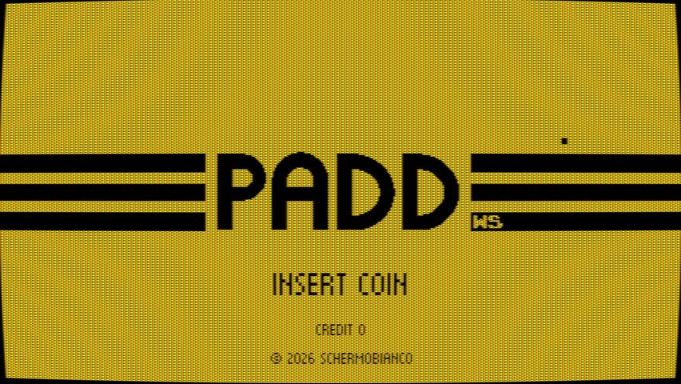 | 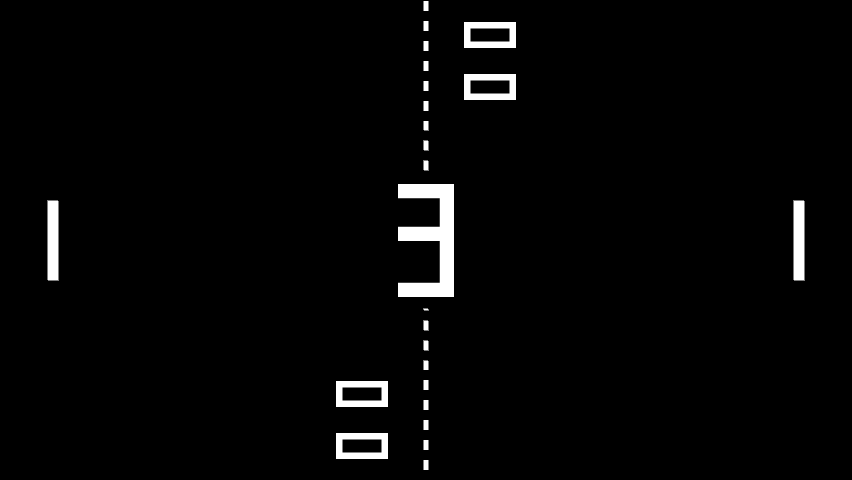 |
| Titolo dell'attract, con il filtro CRT | Conto alla rovescia prima del servizio |
| 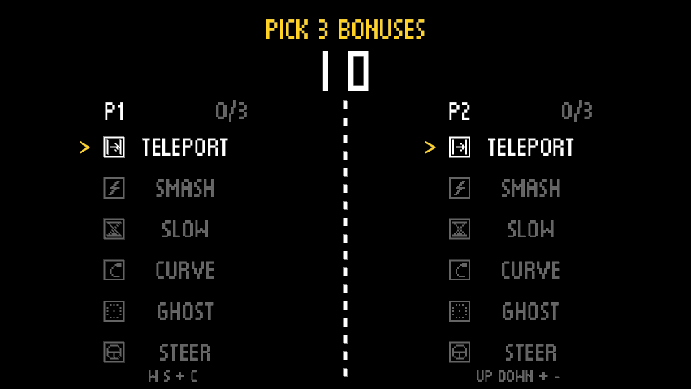 | 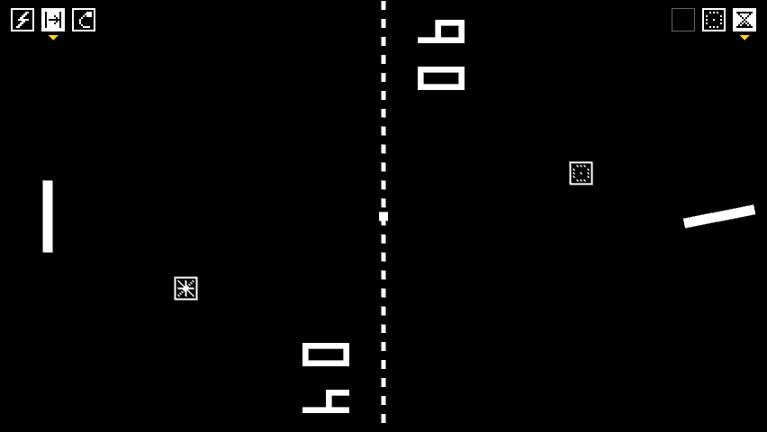 |
| NEXT: ognuno sceglie 3 bonus su 6 | NEXT: riserve in alto, capsule in volo, racchetta che ruota con il SUPER |
| 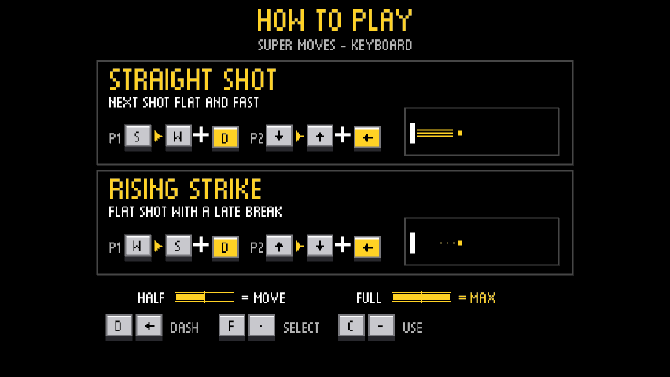 | 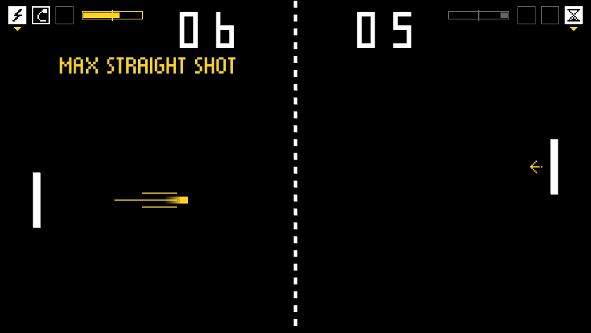 |
| NEXT: HOW TO PLAY, le mosse speciali prima della partita | NEXT: barre delle mosse accanto alle riserve, STRAIGHT SHOT in volo |
| 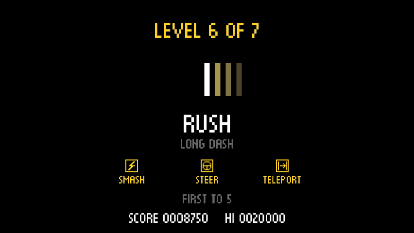 | 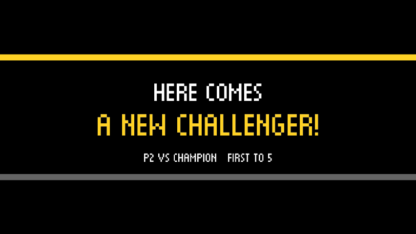 |
| CHALLENGE: presentazione del sesto avversario, RUSH | CHALLENGE: entra un secondo giocatore |
| 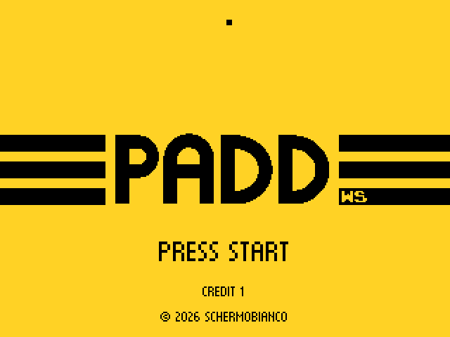 | 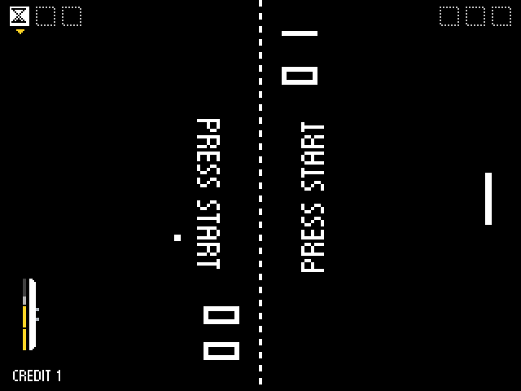 |
| Core MiSTer a 320×240: titolo dopo il gettone | Core MiSTer: demo CPU contro CPU della modalità scelta (qui NEXT) |
| 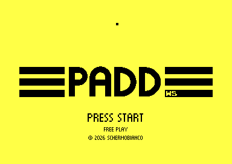 | 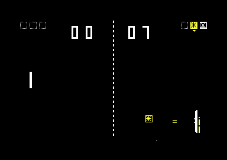 |
| Commodore 64: titolo in Free Play | Commodore 64: NEXT contro la CPU, con la capsula di CURVE |
| 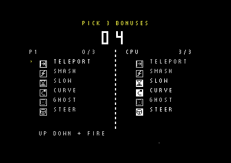 | 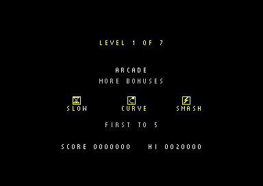 |
| Commodore 64: scelta dei bonus (la CPU ha già scelto) | Commodore 64: presentazione del primo avversario di CHALLENGE |

Le schermate PC vengono da `paddws --screenshot-tour DIR` (versione Rust), quelle MiSTer dalla
simulazione del core con Verilator (`mister/sim/frames`), quelle C64 da VICE (`c64/shot.ps1`).
