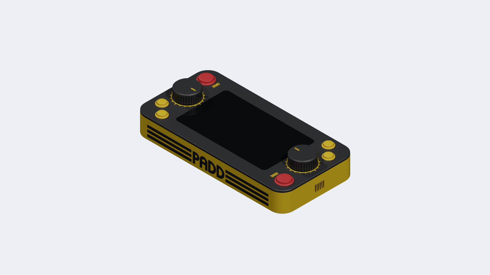
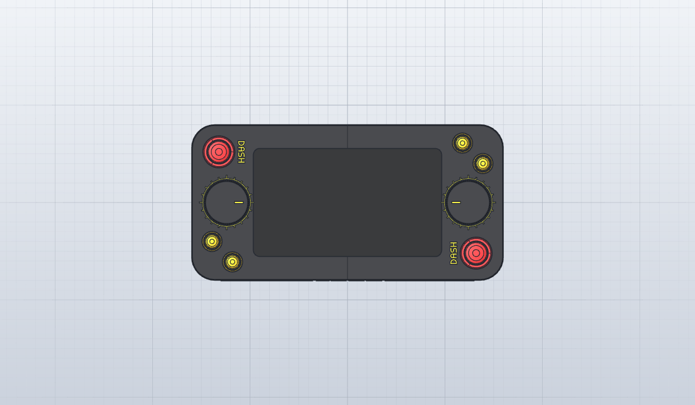
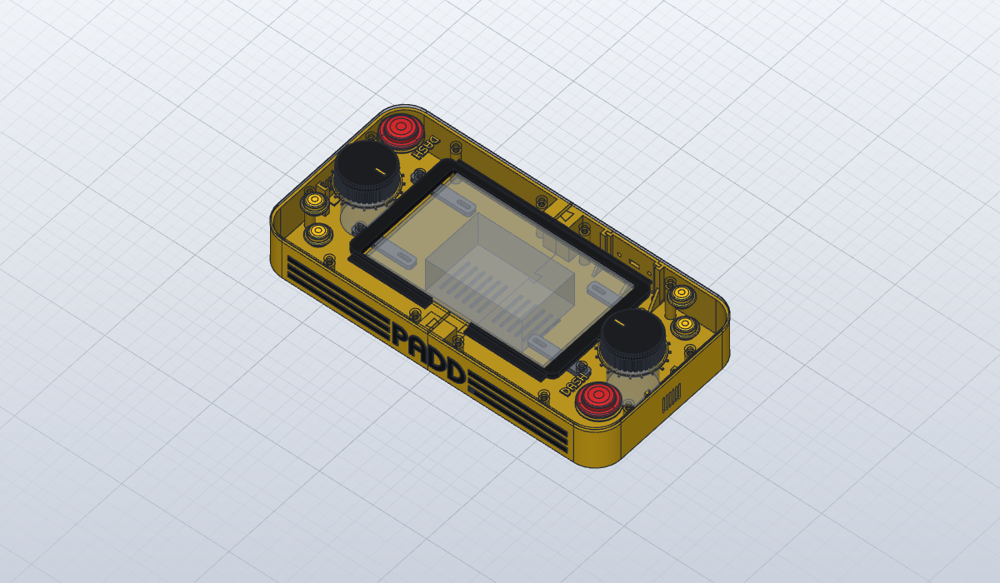
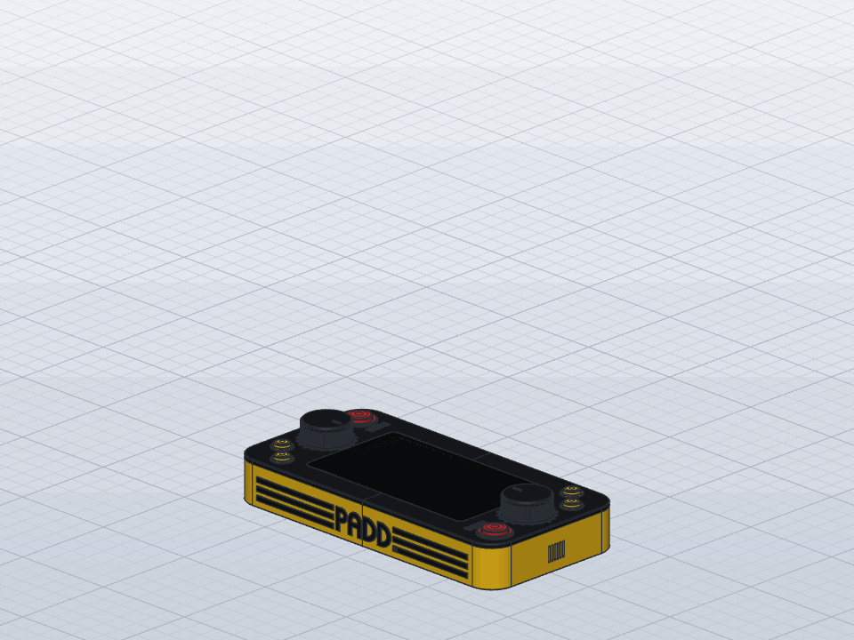

[ Italiano](README.md) · [ **English**](README.en.md)

# Deck

> **Not tested yet.** The Deck has not been fully printed and tried out yet: dimensions, parts and
> instructions will change in the next revisions.

A table-top console for PADD WS: a flat 320 × 160 × 47.5 mm box with the official 7" screen in the
middle and one station per player at each end (knob, DASH, SELECT, USE). Every part is a single
colour and prints without supports; all parts fit on the 256 mm build plate.

| | |
|---|---|
|  |  |

Exploded view, with the parts in assembly order. The display, the board with the Pi and the
encoders, in transparent grey, are bought parts and are not printed.

The parameter and part names in the model are in Italian: *piano* is the top plate, *vasca* the
tray (the bottom shell), *cornice* the glass frame, *manopola* the knob and *mozzo* its hub. G1 and G2 are the two halves, one per player.

## Files

| file | what |
|---|---|
| `deck.sc` | the model for SolidCraft, with the timeline and the main parameters |
| `deck.step` | all the parts to print, for other CAD programs |
| `parts/*.3mf` | the same parts split up, one file per group, oriented as in the model, with the spare power socket plates; the G1 and G2 halves of top plate and tray are the `-P1` and `-P2` files |
| `deck-bambu-studio.3mf` | the Bambu Studio project (X1 Carbon, 0.20 mm Standard): all parts already turned to their print orientation and split into 6 plates, each of a single colour and material |

In the `.sc` file, the parameters window changes `lunghezza` (length), `larghezza` (width),
`raggio` (corner radius), `parete` (wall thickness) and `vetro_sp` (glass thickness).

## Parts to print

Everything is in `deck-bambu-studio.3mf`, the Bambu Studio project: the parts are already turned to
their print orientation (none needs supports) and split into six plates, each of a single colour
and material. The filament only changes between one plate and the next, never during a print.

| plate | parts | filament |
|---|---|---|
| 1 | G1 half of the top plate (face down), logo pieces | 1: black PETG |
| 2 | G2 half of the top plate, 2 knobs (upside down), 10 knob hubs | 1: black PETG |
| 3 | glass frame (flange on the build plate), 4 display bars (upside down) | 1: black PETG |
| 4 | G1 half of the tray (upright), 2 notch rings, 2 pointers, 8 DASH letters | 2: yellow PETG |
| 5 | G2 half of the tray, micro-USB socket plate (face down) | 2: yellow PETG |
| 6 | 8 feet | 3: TPU 95A |

The top plate prints face down: its top is the face on the build plate and takes its finish, for
example the texture of a textured PEI plate. That is why the glass seat is a separate part, the
frame, glued in from below. Its lip goes into the opening of the top plate and centres it, and the
glass rests on it, flush with the top plate. Under the top plate are the tubes for the inserts,
which grow upwards during the print.

The project is for the X1 Carbon with a 0.4 mm nozzle and the 0.20mm Standard profile, with Bambu
PETG Basic and TPU 95A HF filaments; with other filaments, change them in the list on the left.
Top plate, frame, tray and knobs already have 3 walls and 15% infill.

The parts to glue are 1.2 mm thick and go 0.6 mm deep into seats with 0.15 mm of clearance per side;
on PETG, cyanoacrylate glue alone holds poorly: better with its primer for difficult plastics, or
print the parts to glue in PLA.

## Knob hubs

The knob doesn't go straight onto the encoder shaft: inside it has a toothed seat, where a hub with
the D-shaped hole is glued. Small printed holes come out tighter than designed, by an amount that
depends on printer and filament; that is why there are hubs with five different clearances, two of
each, told apart by the notches on the flange:

| notches | clearance per side around the shaft |
|---|---|
| 1 | 0.10 mm |
| 2 | 0.15 mm |
| 3 | 0.20 mm (the one in the model) |
| 4 | 0.25 mm |
| 5 | 0.30 mm |

Try them on the shaft and keep the two that go on with a firm push without wobbling. The hub goes
into the knob in any of the 10 tooth positions, with 0.2 mm of clearance: the teeth drive the knob,
the glue only keeps it from coming off. The flange at the bottom holds the washers in their seat.

## Power socket plate

The power socket sits on an interchangeable plate, in the back side. The plate fills a notch in the
wall, open at the top, and has two wings at the back that slide into C-shaped guides. It goes in
from above before closing the top plate, which then holds it down. When you push the plug in, the
guides and a support in the middle at the bottom take the load; when you pull it out, the wall does.
The guides have feet and gussets at the bottom.

The face is 43.6 mm wide and 34.3 mm high, as thick as the wall (2.5 mm). Behind it, between the
wings, there are 40 mm of width for the socket; under the middle there is the 5 mm high support.

| file | socket |
|---|---|
| `parts/power-plate-micro-usb.3mf` | panel-mount micro-USB extension with two M3 screws 28 mm apart (the one in the Bambu Studio project) |
| `parts/power-plate-micro-usb-snap.3mf` | square snap-in micro-USB extension, no screws: 26.2 × 13.2 opening for the 30 × 18 flange |
| `parts/power-plate-usb-c.3mf` | round USB-C socket with nut, Ø12.2 hole (M12 thread) |
| `parts/power-plate-dc-jack.3mf` | 5.5 × 2.1 DC jack with 8 mm thread and 6 mm toggle switch |
| `parts/power-plate-blank.3mf` | solid: to be drilled, or redesigned starting from `deck.step` |

The plates print face down, so the visible side comes out smooth. In the model the spare plates are
hidden behind the console.

## Shopping list

| qty | what |
|---|---|
| 1 | Raspberry Pi 2, with the Deck SD card image ([deploy/raspberry/deck](../../deploy/raspberry/deck/README.en.md): a trimmed-down 32-bit Raspberry Pi OS, with the `linux-armv7` executable) |
| 1 | official Raspberry Pi 7" display (800 × 480), with the DSI cable |
| 2 | LPD3806-600BM-G5-24C optical encoders |
| 2 | 30 mm snap-in arcade buttons, Sanwa OBSF-30 (DASH): 30 mm hole, Ø33.2 bezel; they clip into the top plate, thinned to 3 mm around the hole by a recess from below; they need 35.5 mm under the top plate |
| 4 | Ø16 mm momentary panel buttons with nut (SELECT, USE), normally open, with at least 6 mm of thread; there are 35 mm of room under the top plate |
| 1 | panel-mount micro-USB extension with two M3 screws 28 mm apart (or another socket, with its plate: see above) |
| 1 | micro-USB Y splitter cable: from the extension to the Pi 2 and to the display's micro-USB; this way the display's 5V and GND pins stay free, with no wires to the GPIO |
| 1 | PAM8403 amplifier and 2 slim Ø28 speakers (8 Ω, 2 W, up to 5.4 mm thick), slotted into the guides of the short sides, one in front of each player |
| 1 | audio cable with a 3-pole 3.5 mm stereo male jack (TRS, not 4-pole), 20-30 cm (a cut audio cable or a "3.5 mm jack to bare wires" lead): from the Pi 2 audio socket to the PAM8403 input (tip = L, ring = R, sleeve = GND) |
| 1 | 5.1 V 2.5 A micro-USB power supply, or a power bank with a USB-A output of at least 2.4 A |
| 1 | microSD card of at least 8 GB |
| - | female Dupont jumper wires for the GPIO, 4.8 mm spade connectors for the buttons |
| 12 | M4 brass heat-set inserts, 6 mm wide, 6 (or 4) mm long (holes 5.6 × 6.5): in the tubes under the top plate, for the tray screws |
| 4 | M3 × 5 × 4 brass heat-set inserts (Voron style: Ø5 at the top, 4 mm long; holes 4.4 × 4.5): in the tubes under the top plate, for the bars |
| 12 | M4 × 30 pan head screws (DIN 7985): from under the tray, inside the pillars, into the inserts of the top plate tubes |
| 8 | M3 × 10 pan head screws (DIN 7985): bars → top plate tubes and bars → display frame |
| 6 | M3 × 10 flat countersunk screws (DIN 965): encoders → top plate, from above, flush with the top plate; 6 mm go into the encoder |
| 4 | M12 washers (24 × 13 × 2.5), two per knob: they act as a flywheel |

Encoder wiring and configuration: [deploy/raspberry/README.en.md](../../deploy/raspberry/README.en.md),
optical encoder diagram (`pulses_per_revolution: 600`, `debounce_us: 0`).

## Assembly

1. Heat-set inserts into the tubes under the top plate (12 M4 for the tray screws, 4 M3 for the
   bars), with the soldering iron tip at about 230-240 °C for PETG. Above the inserts there are 4.5 mm of
   top plate left (4 above those for the bars).
2. Lay the two halves of the top plate face down, pushed together at the joint, and glue the glass
   frame from below: the lip goes into the opening and aligns the halves, the flange is glued under
   the top plate. The frame straddles the joint and joins the two halves.
3. Glue rings, DASH letters and pointers into their seats in the top plate and the knobs, and the
   logo into the seats on the side of the tray. The letters straddling the joint are glued after
   joining the halves.
4. Put the display into the opening from above, with the glass on the lip of the frame, and screw
   the four short bars underneath, one per corner: to the display frame (slot, on the boss of the
   hole) and to the top plate tube. Under the screw heads the bars have raised pads, so the
   M3 × 10 screws don't reach the bottom of the holes. The bars hold the glass against the frame: tighten them without
   forcing, because the frame is only glued. The middle of the frame stays free for the display
   board and the Pi, with their connectors.
5. Encoders from below, with 3 screws from above each; SELECT and USE with their nut; DASH snaps
   into its hole; the Raspberry Pi behind the display, on its standoffs.
6. Tray: lower the G2 half onto G1 from above, sliding the dovetails into their seats. Screw the
   socket to its plate and slide the plate from above into the guides of the back side. Slide the
   speakers from above into the guides of the short sides, with the cone towards the slots. The rim
   rests on two spacers of the wall, so the membrane stays 1.5 mm from the plastic; the ribs on the
   lip get squashed and hold them still, without vibrating. If the rim is thinner than the groove
   (5.7 mm), a ring of adhesive foam on the rim, on the lip side, takes up the play.
7. Wire everything, place the top plate on the tray and screw it from below with the 12 M4 × 30
   screws, which run inside the pillars; the heads sit in the seats at the bottom of the pillars.
8. Washers into the seat under the knob, then the chosen hub from below, through the washers, glued
   into the toothed seat: the hub's flange closes the washers in their seat. Then the knobs onto the
   shafts, with no grub screw. Finally the feet under the tray.

## To check before printing

- **Glass thickness** (`vetro_sp`, now 1.1 mm): the official drawing doesn't give it. Measure it
  with a caliper and change the parameter: the lip of the frame is rebuilt by itself.
- **Glass corner radius** (now 6.5 mm: not dimensioned, 6.5-7 mm measured on samples) and **M3
  holes of the frame**: the slots of the bars take up ±4 mm in length, not in width.
- **Height of the M3 hole bosses** (now 2.5 mm from the back of the frame, i.e. 8.46 mm from the
  glass): the bars rest there. If they stick out less, the bars pull the display down and the glass
  sinks below the top plate: put an M3 washer between bar and boss. If they stick out more, the
  bars push the glass out of the frame: put a washer between bar and tube.
- **Top plate thickness around DASH** (now 3 mm): sellers give the Sanwa OBSF-30 for panels from 2
  to 3.7-4 mm. What counts is the distance between the underside of the bezel and the teeth of the
  clips.
- **Shaft hole in the hubs**: designed for a Ø6 shaft with its flat 2.1 mm from the axis (a little
  over 5 mm from the round side), plus the hub's clearance. If none of the five hubs fits, change
  the clearances.
- **Insert holes** (now Ø5.6 for the 6 mm wide M4 inserts and Ø4.4 for the M3 × 5 × 4 ones, as
  recommended by CNC Kitchen and ruthex): with other brands, try the insert in a test hole before
  printing the top plate.
- **Speaker thickness** (now 5.4 mm, the stated total thickness): what counts is the thickness in
  the outer 2 mm, where the lip of the guides holds them. If it is thinner, a ring of foam on the
  rim takes up the play; or adapt the guides to the measured thickness.
- **Power socket**: the micro-USB plate is for an extension with screws 28 mm apart. With another
  socket, use or redesign another plate: the rest of the console doesn't change. On the snap-in
  plate the clips must catch behind the 2.5 mm face: the dimensions are the seller's.
- **Encoders**: sellers' dimensions (body Ø38 × 35.5, collar Ø20 × 5, Ø6 × 13 shaft with a flat a little over 5 mm from the round side, M3
  holes on a Ø30 circle).
