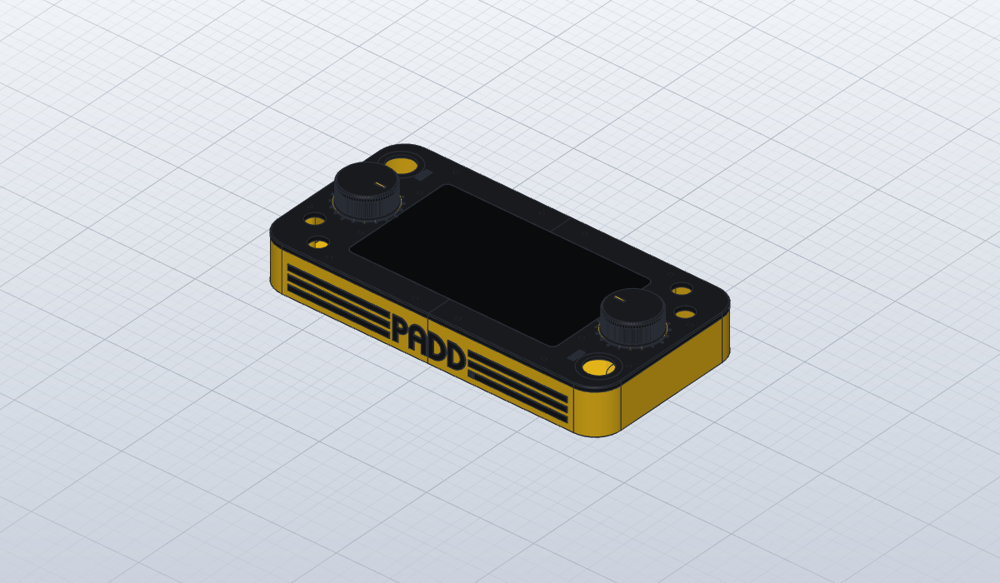
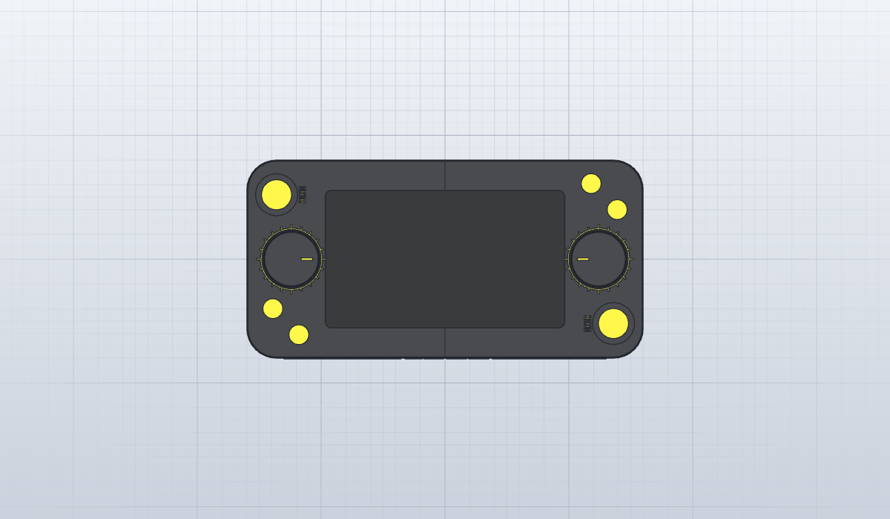
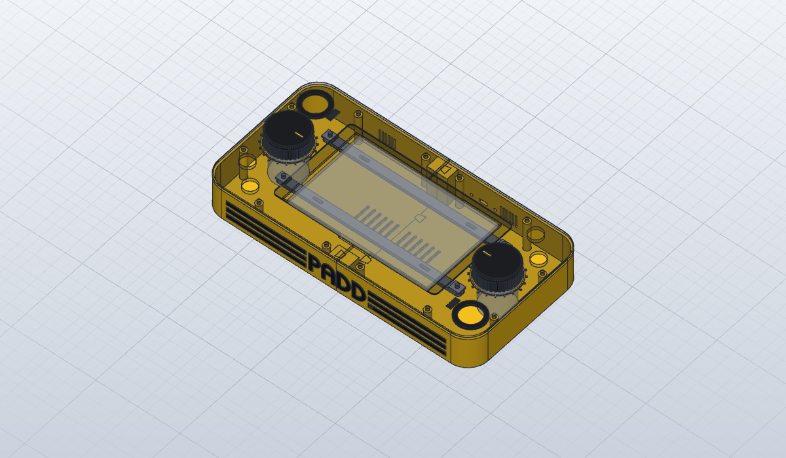

# Deck

Console da tavolo per PADD WS: una scatola piatta di 320 × 160 × 47,5 mm con lo schermo ufficiale da 7" al
centro e una postazione per giocatore a ogni capo (manopola, DASH, SELECT, USE). Ogni pezzo è di un
solo colore e si stampa senza supporti; tutti i pezzi entrano sul piatto da 256 mm.

| | |
|---|---|
|  |  |

## File

| file | cosa |
|---|---|
| `deck.sc` | il modello per SolidCraft, con la timeline e i parametri principali |
| `deck.step` | tutti i pezzi da stampare, per altri CAD |
| `parts/*.3mf` | gli stessi pezzi separati, un file per gruppo, nel verso del modello |
| `deck.3mf` | il progetto per Bambu Studio (X1 Carbon, 0,20 mm Standard): tutti i pezzi già girati nel verso di stampa e divisi in 5 piatti, uno per colore e materiale |

Nel file `.sc` si cambiano dalla finestra dei parametri `lunghezza`, `larghezza`, `raggio`,
`parete` e `vetro_sp`.

## Pezzi da stampare

Tutto sta in `deck.3mf`, il progetto per Bambu Studio: i pezzi sono già girati nel verso di
stampa (nessuno richiede supporti) e divisi in cinque piatti, uno per colore e materiale. Si
cambia solo il filamento tra un piatto e l'altro, mai durante una stampa.

| piatto | pezzi | filamento |
|---|---|---|
| 1 | metà G1 del piano (a faccia in su), 2 manopole (capovolte), pezzi del logo | 1: PETG nero |
| 2 | metà G2 del piano, 2 barre del display (rialzi in su), 2 dischi di DASH | 1: PETG nero |
| 3 | metà G1 della vasca (dritta), 2 anelli delle tacche, 2 indicatori, 8 lettere di DASH | 2: PETG giallo |
| 4 | metà G2 della vasca | 2: PETG giallo |
| 5 | 8 piedini | 3: TPU 95A |

Il progetto è per la X1 Carbon con ugello da 0,4 mm e il profilo 0.20mm Standard, con i filamenti
Bambu PETG Basic e TPU 95A HF; se si usano altri filamenti si cambiano nell'elenco a sinistra.
Piano, vasca e manopole hanno già 3 perimetri e il 15% di riempimento, il piano la stiratura
dell'ultimo strato.

Il progetto usa il PETG (Bambu PETG Basic nero e giallo, TPU 95A HF per i piedini). I pezzi da incollare sono spessi 1,2 mm ed entrano per 0,6 mm in sedi con 0,15 mm di
gioco per lato; sul PETG l'Attack (cianoacrilato) tiene poco da solo: meglio con il suo primer per
plastiche difficili, oppure stampare i pezzi da incollare in PLA.

## Da comprare

| q.tà | cosa |
|---|---|
| 1 | Raspberry Pi 2, con Raspberry Pi OS a 32 bit e l'eseguibile `linux-armv7` |
| 1 | display ufficiale Raspberry Pi 7" (800 × 480), con il cavo DSI |
| 2 | encoder ottici LPD3806-600BM-G5-24C |
| 2 | pulsanti arcade da 24 mm a scatto (DASH): si agganciano al disco da 2 mm incassato nel piano (lo spessore va adattato al pulsante) |
| 4 | pulsanti momentanei da pannello Ø16 mm con il dado (SELECT, USE), normalmente aperti, con almeno 6 mm di filetto; sotto il piano c'è posto per 35 mm |
| 1 | prolunga micro-USB da pannello (foro 9 × 4, viti a 28 mm: da adattare al connettore) |
| 1 | amplificatore PAM8403 e 2 altoparlanti Ø28 con il bordo spesso 3 mm, a incastro nelle guide del fianco posteriore |
| 18 | inserti in ottone a caldo M3 × 3, diametro esterno circa 4,2 (fori da 4,0): 12 nel piano, 4 per le barre, 2 nelle manopole. Corti: il piano è spesso 4 mm |
| 12 | viti M3 × 40 a testa bombata (ISO 7380): da sotto la vasca, dentro le colonnine, negli inserti del piano |
| 4 | viti M3 × 8: barre → piano |
| 4 | viti M3 × 6: barre → telaio del display |
| 6 | viti M3 × 6 a testa bassa: encoder → piano (sotto le manopole restano 2 mm) |
| 2 | grani M3 × 5 per le manopole |
| 4 | rondelle M12 (24 × 13 × 2,5), due per manopola: fanno da volano |

Collegamenti e configurazione degli encoder: [deploy/raspberry/README.md](../../deploy/raspberry/README.md),
schema degli encoder ottici (`pulses_per_revolution: 600`, `debounce_us: 0`).

## Montaggio

1. Inserti a caldo da sotto nel piano (12 per le viti della vasca, 4 per le barre) e di fianco nelle
   manopole. Nel piano l'inserto arriva a 0,7 mm dalla superficie: va spinto piano e dritto, con la
   punta del saldatore a circa 230-240 °C per il PETG.
2. Incollare anelli, lettere di DASH e indicatori nelle sedi del piano e delle manopole, e il logo
   nelle sedi del fianco della vasca. Le lettere che stanno a cavallo della giunta si incollano dopo
   aver unito le metà.
3. Appoggiare le due metà del piano a faccia in giù, mettere il display nella sede dall'alto e
   avvitare sotto le due barre: al telaio del display (asole) e al piano. Le barre tengono il vetro
   contro la battuta e uniscono le due metà del piano.
4. Encoder da sotto, con 3 viti dall'alto ciascuno; SELECT e USE con il dado; per DASH il disco nella
   sua sede (una goccia di Attack) e il pulsante agganciato al disco; il Raspberry dietro al display,
   sui suoi distanziali.
5. Vasca: calare la metà G2 sulla G1 dall'alto, facendo entrare le code di rondine nelle sedi.
   Montare la presa sul fianco posteriore e infilare dall'alto gli altoparlanti nelle loro guide,
   con il cono verso le feritoie: le costole sul labbro si schiacciano e li tengono fermi contro
   la parete, senza vibrare. Un anello di gommapiuma adesiva sul bordo li isola ancora di più.
6. Cablare, appoggiare il piano sulla vasca e avvitarlo da sotto con le 12 viti M3 × 40, che passano
   dentro le colonnine.
7. Rondelle nella sede sotto le manopole, manopole sugli alberi (il piano dell'albero verso il grano),
   piedini sotto la vasca.

## Da verificare prima di stampare

- **Spessore del vetro** (`vetro_sp`, ora 1,1 mm): il disegno ufficiale non lo quota. Si misura
  col calibro e si cambia il parametro: la sede si rifà da sola.
- **Raggio degli angoli del vetro** (ora 5 mm, stimato) e **fori M3 del telaio**: le asole delle
  barre assorbono ±4 mm in lunghezza, non in larghezza.
- **Spessore del disco di DASH** (ora 2 mm): la distanza tra il sotto della ghiera e i
  ganci del pulsante a scatto.
- **Bordo degli altoparlanti** (ora 3 mm): se è più sottile le costole non bastano a tenerli.
- **Connettore di alimentazione**: foro e viti sono per una prolunga micro-USB tipica.
- **Encoder**: misure dei venditori (corpo Ø38 × 35,5, collare Ø20 × 5, albero Ø6 × 13 con il piano,
  fori M3 sul cerchio Ø30).
